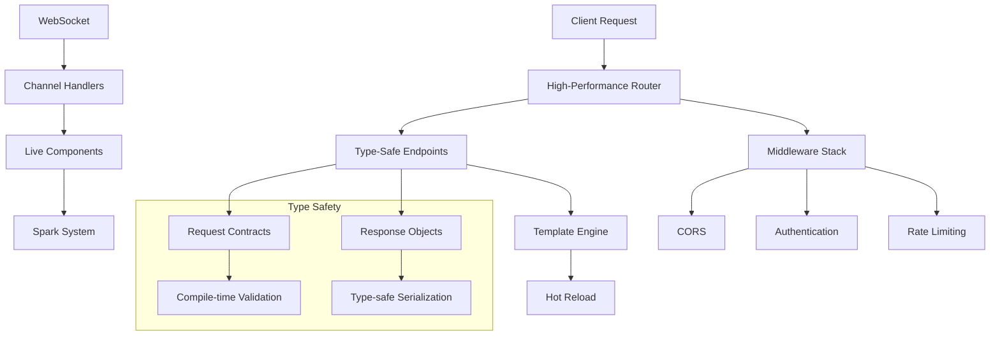

<div style="text-align:center"></div>

# Azu Web Framework

[](https://www.codacy.com/manual/eliasjpr/azu?utm_source=github.com&utm_medium=referral&utm_content=eliasjpr/azu&utm_campaign=Badge_Grade) [](https://github.com/azutoolkit/azu/actions/workflows/crystal.yml) [](https://github.com/azutoolkit/azu/actions/workflows/github-code-scanning/codeql)

**Azu** is a high-performance, type-safe web framework for Crystal that emphasizes developer productivity, compile-time safety, and real-time capabilities. Built with modern web development patterns, Azu provides a robust foundation for building scalable applications with elegant, expressive syntax.

## Quick Start

Save this as `hello.cr`, with `azu` in your `shard.yml` (see Installation above):

```crystal
require "azu"

module HelloApp
  include Azu
end

# A response turns your data into the body that is sent
struct HelloResponse
  include Azu::Response

  def initialize(@name : String)
  end

  def render
    {message: "Hello, #{@name}!"}.to_json
  end
end

# A type-safe endpoint: Endpoint(RequestType, ResponseType)
struct HelloEndpoint
  include Azu::Endpoint(Azu::Request, HelloResponse)

  get "/hello/:name"

  def call : HelloResponse
    content_type "application/json"
    HelloResponse.new params["name"]
  end
end

# Start the server (PORT defaults to 4000)
HelloApp.start [
  Azu::Handler::RequestId.new,
  Azu::Handler::Rescuer.new,
  Azu::Handler::Logger.new,
] of HTTP::Handler
```

```bash
crystal run hello.cr
curl http://localhost:4000/hello/Crystal
# {"message":"Hello, Crystal!"}
```

## Key Features

- **Type-Safe**: Compile-time type checking for requests, responses, and parameters
- **Real-Time**: WebSocket channels and live components with client-server synchronization
- **Performance**: High-performance routing with LRU cache and path optimization
- **Developer Experience**: Comprehensive error handling, content negotiation, and flexible middleware
- **OpenAPI 3.1**: The document is generated from your `Endpoint(Request, Response)` contracts and validations, and `Azu::OpenAPI::Handler` serves it (see [docs/reference/api/openapi.md](docs/reference/api/openapi.md))

## 🚀 Key Features

### Type-Safe Architecture

- **Compile-time type checking** for requests, responses, and parameters
- **Type-safe endpoint pattern** with structured request/response contracts
- **Zero-runtime overhead** parameter validation and serialization

### Real-Time Capabilities

- **WebSocket channels** with automatic connection management
- **Live components** with client-server synchronization
- **Spark system** for reactive UI updates without page reloads

### Performance-Optimized

- **High-performance routing** with LRU cache and path optimization
- **Template hot reloading** in development with production caching
- **Efficient file upload handling** with streaming and size limits

### Developer Experience

- **Comprehensive error handling** with detailed debugging information
- **Content negotiation** supporting JSON, HTML, XML, and plain text
- **Flexible middleware system** for cross-cutting concerns
- **Environment-aware configuration** with sensible defaults

## 📊 Performance Characteristics

- **Sub-millisecond routing** with cached path resolution
- **Memory-efficient** request/response handling
- **Concurrent WebSocket** connections with lightweight fiber-based architecture
- **Zero-allocation** parameter parsing for common scenarios
- **Template compilation** with optional hot-reloading for development

## 🏗️ Architecture Overview



## 🛠️ Installation

1. Add the dependency to your `shard.yml`:

```yaml
dependencies:
  azu:
    github: azutoolkit/azu
    version: ~> 0.5.73
```

Azu needs Crystal 1.19.1 or newer (`crystal: ">= 1.19.1"`).

2. Run `shards install`

3. Require Azu in your application:

```crystal
require "azu"
```

## 🎯 Complete Quickstart Guide

This guide walks through building a complete Azu application in logical order. It keeps users in memory so
every step runs without a database; step 5 shows how to swap in [CQL](https://github.com/azutoolkit/cql).
The files are written to a `my_app/` project. Blocks that use types from earlier steps are
marked as fragments in the Markdown source.

### 1. Project Configuration

Create your main application file. `configure` yields the configuration, so settings are assigned on the
block argument:

```crystal
# src/my_app.cr
require "azu"

module MyApp
  include Azu

  configure do |config|
    # Server settings (PORT and HOST are also read from the environment by default)
    config.port = ENV.fetch("PORT", "4000").to_i
    config.host = ENV.fetch("HOST", "0.0.0.0")

    # Template configuration
    config.templates.path = "src/templates"
    config.template_hot_reload = config.env.development?

    # File upload configuration
    config.upload.max_file_size = 50_u64 * 1024 * 1024
    config.upload.temp_dir = "tmp/uploads"

    # Cache configuration
    config.cache_config.enabled = true
    config.cache_config.store = "memory"
    config.cache_config.max_size = 1000
    config.cache_config.default_ttl = 300
  end
end
```

### 2. Server Startup

Create a dedicated server file that requires your application files and starts the server. The handler
array is typed `of HTTP::Handler`, and the handlers run in the order listed:

<!-- skip -->
```crystal
# server.cr
require "./src/my_app"
require "./src/models/*"
require "./src/requests/*"
require "./src/responses/*"
require "./src/endpoints/*"
require "./src/channels/*"

MyApp.start [
  Azu::Handler::RequestId.new, # Request ID tracking
  Azu::Handler::Rescuer.new,   # Error handling
  Azu::Handler::Logger.new,    # Request logging
] of HTTP::Handler
```

To run your application:

```bash
# Development
crystal run server.cr

# Production build
crystal build server.cr --release
./server

# With environment variables
CRYSTAL_ENV=production PORT=8080 crystal run server.cr
```

### 3. Request Contracts with Validation

Define type-safe request objects. `validate` takes a field and one or more rules: `presence`, `size`
(an `Int` or a `Range`), `match` (a `Regex`), `in` (an `Array` or a `Range`), `eq`, `gt`, `gte`, `lt`,
`lte`, `exclude`, `required`, plus an optional `message`:

```crystal
# src/requests/user_request.cr
struct UserRequest
  include Azu::Request

  getter name : String
  getter email : String
  getter age : Int32?

  def initialize(@name = "", @email = "", @age = nil)
  end

  validate name, size: 2..50, message: "Name must be between 2 and 50 characters."
  validate email, match: /\A[^@\s]+@[^@\s]+\.[^@\s]+\z/, message: "Enter a valid email address."
end

# src/requests/search_request.cr
struct SearchRequest
  include Azu::Request

  @query : String = ""
  @page : Int32 = 1
  @per_page : Int32 = 20
  @sort : String = "name"

  getter query, page, per_page, sort

  validate query, presence: true
  validate page, gt: 0
  validate per_page, in: 1..100
  validate sort, in: %w(name email)
end

UserRequest.new(name: "A", email: "nope").errors.map(&.message)
# => ["Name must be between 2 and 50 characters.", "Enter a valid email address."]
SearchRequest.from_query("query=ada&page=2").valid? # => true
```

### 4. Custom Validators

For rules that need code, subclass `Schema::Validator`, return the errors from `valid?`, and register it
with `use`. The validator receives the request as `@record`:

```crystal
# src/validators/unique_email_validator.cr
class UniqueEmailValidator < Schema::Validator
  TAKEN = ["ada@example.com"]

  def initialize(@record : SignupRequest)
  end

  def valid? : Array(Schema::Error)
    errors = [] of Schema::Error
    errors << Schema::Error.new(:email, "Email has already been taken!") if TAKEN.includes?(@record.email)
    errors
  end
end

struct SignupRequest
  include Azu::Request

  getter email : String

  def initialize(@email = "")
  end

  validate email, presence: true
  use UniqueEmailValidator
end

SignupRequest.new(email: "ada@example.com").errors.map(&.message)
# => ["Email has already been taken!"]
```

### 5. Data Models

The guide keeps users in memory, behind a small store you can replace:

```crystal
# src/models/user.cr
struct User
  getter id : Int64
  property name : String
  property email : String

  def initialize(@id, @name, @email)
  end
end

module Users
  @@all = [] of User
  @@next_id = 1_i64
  @@lock = Mutex.new

  def self.create(name : String, email : String) : User
    @@lock.synchronize do
      user = User.new(@@next_id, name, email)
      @@next_id += 1
      @@all << user
      user
    end
  end

  def self.find?(id : Int64) : User?
    @@lock.synchronize { @@all.find { |user| user.id == id } }
  end

  def self.search(term : String) : Array(User)
    @@lock.synchronize { @@all.select { |user| user.name.downcase.includes?(term.downcase) } }
  end
end
```

To use a database, add [CQL](https://github.com/azutoolkit/cql) and its `azu/cql` bridge, which instruments
queries for the development dashboard (see [Database dashboard](docs/reference/database-dashboard.md)):

```crystal
require "azu/cql"
require "sqlite3"

module Blog
  BlogDB = Azu::CQL.schema(:blog, "sqlite3://./blog.db") do
    table :users do
      primary :id, Int64
      column :name, String
      column :email, String
    end

    table :posts do
      primary :id, Int64
      column :user_id, Int64
      column :title, String
    end
  end

  class Post
    include ::CQL::ActiveRecord::Model(Int64)
    db_context schema: BlogDB, table: :posts

    property user_id : Int64
    property title : String

    belongs_to :user, Blog::User, :user_id

    def initialize(@user_id, @title)
    end
  end

  class User
    include ::CQL::ActiveRecord::Model(Int64)
    db_context schema: BlogDB, table: :users

    property name : String
    property email : String

    has_many :posts, Blog::Post, foreign_key: :user_id

    def initialize(@name, @email)
    end
  end
end
```

### 6. Services (Business Logic)

Organize business logic in plain modules that raise Azu's error types:

<!-- skip -->
```crystal
# src/services/user_service.cr
module UserService
  extend self

  def create_user(request : UserRequest) : User
    unless request.valid?
      field_errors = request.errors.group_by(&.field.to_s).transform_values(&.map(&.message))
      raise Azu::Response::ValidationError.new(field_errors)
    end

    Users.create(request.name, request.email)
  end

  def find_user(id : Int64) : User?
    Users.find?(id)
  end
end
```

### 7. Response Objects

Responses implement `render`, which returns the body:

<!-- skip -->
```crystal
# src/responses/user_response.cr
struct UserResponse
  include Azu::Response
  include JSON::Serializable

  getter id : Int64
  getter name : String
  getter email : String

  def initialize(user : User)
    @id = user.id
    @name = user.name
    @email = user.email
  end

  def render
    to_json
  end
end

# src/responses/user_list_response.cr
struct UserListResponse
  include Azu::Response

  def initialize(@users : Array(UserResponse))
  end

  def render
    {users: @users}.to_json
  end
end

# src/responses/user_page_response.cr
struct UserPageResponse
  include Azu::Response
  include Azu::Templates::Renderable

  def initialize(@user : User)
  end

  def render
    view "users/show.html", {
      "title" => "#{@user.name}'s Profile",
      "name"  => @user.name,
      "email" => @user.email,
    }
  end
end
```

### 8. Type-Safe Endpoints

Endpoints connect a request type to a response type. Path parameters come from `params`, and the
validated request object is available through a method named after its type (`user_request` for
`UserRequest`).

<!-- skip -->
```crystal
# src/endpoints/user_endpoints.cr
struct CreateUserEndpoint
  include Azu::Endpoint(UserRequest, UserResponse)

  post "/api/users"

  def call : UserResponse
    user = UserService.create_user(user_request)
    status 201
    content_type "application/json"
    UserResponse.new(user)
  end
end

struct GetUserEndpoint
  include Azu::Endpoint(Azu::Request, UserResponse)

  get "/api/users/:id"

  def call : UserResponse
    user = UserService.find_user(params["id"].to_i64) || raise Azu::Response::NotFound.new(context.request.path)
    content_type "application/json"
    UserResponse.new(user)
  end
end

struct SearchUsersEndpoint
  include Azu::Endpoint(SearchRequest, UserListResponse)

  get "/api/users"

  def call : UserListResponse
    search = search_request
    users = Users.search(search.query).first(search.per_page)
    content_type "application/json"
    UserListResponse.new(users.map { |user| UserResponse.new(user) })
  end
end

struct UserProfilePageEndpoint
  include Azu::Endpoint(Azu::Request, UserPageResponse)

  get "/users/:id"

  def call : UserPageResponse
    user = UserService.find_user(params["id"].to_i64) || raise Azu::Response::NotFound.new(context.request.path)
    content_type "text/html"
    UserPageResponse.new(user)
  end
end
```

Upload endpoints read files from `params.files`; see [File Uploads](#-file-uploads).

### 9. Crinja Templates with Layouts

Templates live in the configured templates path (`src/templates` above) and use
[Crinja](https://github.com/straight-shoota/crinja), a Jinja2 implementation:

```html
<!-- src/templates/layouts/base.html -->
<!DOCTYPE html>
<html lang="en">
  <head>
    <meta charset="UTF-8" />
    <meta name="viewport" content="width=device-width, initial-scale=1.0" />
    <title>My App</title>
  </head>
  <body>
    <nav><a href="/">My App</a></nav>
    <main></main>
  </body>
</html>

<!-- src/templates/users/show.html -->

{{ title }}

<h1>{{ name }}</h1>
<p>{{ email }}</p>

```

### 10. Live Components

Create interactive components with real-time updates:

```crystal
# src/components/counter_view.cr
class CounterView < Azu::Spark::Component
  mountable

  prop label : String = "Clicks"
  state count : Int32 = 0

  event def increment(by : Int32 = 1) : Nil
    self.count += by
  end

  def render
    div do
      h2 "#{label}: #{count}"
      button "+1", **spark_click(:increment)
    end
  end
end

# once at boot: Azu::Spark.install
# in a layout:  Azu::Spark.script_tag
# in a page:    Azu::Spark.render(CounterView, label: "Clicks")
```

See [Spark Live Views](docs/explanation/spark-live-views.md) for the component DSL, PubSub, the
JavaScript client, the security model and the list of breaking changes.

### 11. WebSocket Channels

A channel is a class with a `ws` route and the six callbacks below. `subscribe` joins a topic of the
built-in PubSub (in-process memory by default) and `broadcast` sends a message to every subscriber of
a topic; each subscriber's socket receives the payload as is:

```crystal
# src/channels/chat_channel.cr
class ChatChannel < Azu::Channel
  ws "/chat"

  def on_connect
    subscribe("chat")
    broadcast("chat", {event: "user_joined"}.to_json)
  end

  def on_message(message : String)
    broadcast("chat", {event: "message", text: message}.to_json)
  end

  def on_binary(binary : Bytes)
  end

  def on_ping(message : String)
  end

  def on_pong(message : String)
  end

  def on_close(code, message)
    broadcast("chat", {event: "user_left"}.to_json)
  end
end
```

Query parameters of the upgrade request are available as `params`, and its headers as `headers`.
For a channel that tracks its own sockets, see `playground/channels/example_channel.cr`.

### 12. Custom Middleware

Middleware is an `HTTP::Handler`: do your work, then call `call_next(context)` to continue the chain, or
answer the request yourself to stop it. Azu ships `CORS`, `CSRF`, `Throttle`, `Static` and others
(see [Middleware](#-middleware)).

```crystal
# src/middleware/token_auth.cr
class TokenAuth
  include HTTP::Handler

  PUBLIC_PATHS = ["/", "/health"]

  def initialize(@token : String)
  end

  def call(context : HTTP::Server::Context)
    return call_next(context) if PUBLIC_PATHS.includes?(context.request.path)

    if bearer_token(context.request) == @token
      call_next(context)
    else
      context.response.status = HTTP::Status::UNAUTHORIZED
      context.response.content_type = "application/json"
      context.response.print({error: "Authentication required"}.to_json)
    end
  end

  private def bearer_token(request : HTTP::Request) : String?
    request.headers["Authorization"]?.try { |header| header.lchop?("Bearer ") }
  end
end

module MyApp
  include Azu
end

MyApp.start [
  Azu::Handler::RequestId.new,
  Azu::Handler::Rescuer.new,
  TokenAuth.new(ENV.fetch("API_TOKEN", "secret")),
] of HTTP::Handler
```

### 13. Background Jobs with JoobQ

[JoobQ](https://github.com/azutoolkit/joobq) is a separate shard that processes jobs from Redis.

**Add JoobQ to your `shard.yml`:**

```yaml
dependencies:
  azu:
    github: azutoolkit/azu
    version: ~> 0.5.73
  joobq:
    github: azutoolkit/joobq
    version: ~> 0.4.2
```

**Define a job and configure a queue for it:**

<!-- skip -->
```crystal
# src/jobs/email_job.cr
struct EmailJob
  include JoobQ::Job

  @queue = "default"
  @retries = 3
  @expires = 1.days.total_seconds.to_i

  def initialize(@email_address : String, @subject : String)
  end

  def perform
    Log.info { "Sending #{@subject} to #{@email_address}" }
  end
end

# src/jobs.cr
JoobQ.configure do
  queue "default", 2, EmailJob
end
```

**Enqueue it from an endpoint:**

<!-- skip -->
```crystal
struct CreateUserEndpoint
  include Azu::Endpoint(UserRequest, UserResponse)

  post "/api/users"

  def call : UserResponse
    user = UserService.create_user(user_request)
    EmailJob.enqueue(email_address: user.email, subject: "Welcome to MyApp!")
    status 201
    UserResponse.new(user)
  end
end

# Delayed and recurring
EmailJob.enqueue_at(time: 2.hours.from_now, email_address: "user@example.com", subject: "Reminder")
EmailJob.schedule(every: 1.day, email_address: "team@example.com", subject: "Daily digest")
```

**Run the workers in their own process:**

<!-- skip -->
```crystal
# worker.cr
require "./src/jobs"

JoobQ.forge
sleep
```

```bash
# Start web server
crystal run server.cr

# Start job workers (in a separate terminal)
crystal run worker.cr
```

See the JoobQ documentation for queues, throttling, scheduling and the monitoring API.

### 14. Complete Application Structure

Here's how the project from this guide is laid out:

```
my_app/
├── src/
│   ├── my_app.cr              # Main application configuration
│   ├── models/
│   │   └── user.cr
│   ├── services/
│   │   └── user_service.cr
│   ├── requests/
│   │   ├── user_request.cr
│   │   └── search_request.cr
│   ├── responses/
│   │   ├── user_response.cr
│   │   ├── user_list_response.cr
│   │   └── user_page_response.cr
│   ├── validators/
│   │   └── unique_email_validator.cr
│   ├── endpoints/
│   │   └── user_endpoints.cr
│   ├── channels/
│   │   └── chat_channel.cr
│   ├── middleware/
│   │   └── token_auth.cr
│   ├── components/
│   │   └── counter_view.cr
│   ├── jobs/
│   │   └── email_job.cr
│   └── templates/
│       ├── layouts/
│       │   └── base.html
│       └── users/
│           └── show.html
├── server.cr                  # Application entry point
├── worker.cr                  # Background job worker
├── public/                    # Static assets
└── shard.yml                  # Dependencies
```

This guide demonstrates:

- ✅ **Configuration**: Application setup with environment-aware settings
- ✅ **Server Startup**: A dedicated entry point with an explicit handler chain
- ✅ **Requests**: Type-safe request objects with validation
- ✅ **Custom Validators**: Reusable validation classes inheriting from `Schema::Validator`
- ✅ **Models and Services**: Business logic kept apart from HTTP
- ✅ **Responses**: Structured JSON and HTML responses
- ✅ **Endpoints**: RESTful endpoints with typed contracts
- ✅ **Templates**: Crinja templates with layouts and inheritance
- ✅ **Components**: Live, interactive components with real-time updates
- ✅ **Channels**: WebSocket channels for real-time communication
- ✅ **Middleware**: Custom `HTTP::Handler`s
- ✅ **Background Jobs**: Asynchronous job processing with JoobQ

Each component follows Azu's type-safe patterns and integrates with the framework's architecture.

## 🔌 Real-Time Features

### WebSocket Channels

```crystal
class ChatChannel < Azu::Channel
  ws "/chat"

  def on_connect
    subscribe("chat")
    broadcast("chat", {event: "user_joined", user: params["name"]?}.to_json)
  end

  def on_message(message : String)
    data = JSON.parse(message)
    broadcast("chat", {
      event:     "message",
      user:      params["name"]?,
      text:      data["text"]?.try(&.as_s?),
      timestamp: Time.utc,
    }.to_json)
  end

  def on_binary(binary : Bytes)
  end

  def on_ping(message : String)
  end

  def on_pong(message : String)
  end

  def on_close(code, message)
    broadcast("chat", {event: "user_left", user: params["name"]?}.to_json)
  end
end
```

A client connects with `ws://localhost:4000/chat?name=Ada`.

### Live Components

```crystal
class CounterView < Azu::Spark::Component
  mountable

  state count : Int32 = 0

  event def increment : Nil
    self.count += 1
  end

  event def decrement : Nil
    self.count -= 1
  end

  def render
    div do
      h2 "Count: #{count}"
      button "+", **spark_click(:increment)
      button "-", **spark_click(:decrement)
    end
  end
end

# In your layout and page
Azu::Spark.script_tag
Azu::Spark.render(CounterView)
```

## 🛡️ Error Handling

Azu provides structured error responses. Raise one of the built-in errors from an endpoint (or anywhere
below it) and `Azu::Handler::Rescuer` turns it into a response:

```crystal
# Built-in error types
raise Azu::Response::ValidationError.new("email", "is invalid")
raise Azu::Response::AuthenticationError.new("Login required")
raise Azu::Response::AuthorizationError.new("Admin access required")
raise Azu::Response::RateLimitError.new(retry_after: 60)
raise Azu::Response::NotFound.new("/missing")
raise Azu::Response::BadRequest.new("Malformed input")
```

An endpoint that reports a failed validation with every field's messages:

```crystal
struct SignupRequest
  include Azu::Request

  getter email : String

  def initialize(@email = "")
  end

  validate email, presence: true
end

struct Registered
  include Azu::Response

  def render
    {registered: true}.to_json
  end
end

struct RegisterEndpoint
  include Azu::Endpoint(SignupRequest, Registered)

  post "/signup"

  def call : Registered
    signup = signup_request
    unless signup.valid?
      raise Azu::Response::ValidationError.new(
        signup.errors.group_by(&.field.to_s).transform_values(&.map(&.message))
      )
    end

    content_type "application/json"
    Registered.new
  end
end
```

### Error Response Formats

Azu formats errors based on content negotiation. A JSON error looks like this:

```json
{
  "Status": "unprocessable_entity",
  "Title": "Validation Error",
  "Detail": "The request could not be processed due to validation errors.",
  "FieldErrors": {
    "email": ["Invalid field: email"]
  },
  "ErrorId": "…",
  "Fingerprint": "…",
  "Context": null,
  "Timestamp": "…"
}
```

## 📁 File Uploads

Multipart uploads are streamed to `config.upload.temp_dir` and a file larger than
`config.upload.max_file_size` is rejected. Read the files of a request from `params.files`:

```crystal
struct UploadResponse
  include Azu::Response

  def initialize(@filename : String, @size : UInt64?)
  end

  def render
    {filename: @filename, size: @size}.to_json
  end
end

struct UploadEndpoint
  include Azu::Endpoint(Azu::Request, UploadResponse)

  post "/upload"

  ALLOWED = %w(.jpg .png .gif)

  def call : UploadResponse
    file = params.files["avatar"]? || raise Azu::Response::ValidationError.new("avatar", "is required")
    filename = file.filename.to_s

    unless ALLOWED.includes?(File.extname(filename).downcase)
      raise Azu::Response::ValidationError.new("avatar", "must be one of #{ALLOWED.join(", ")}")
    end

    Dir.mkdir_p("public/uploads")
    File.copy(file.temp_path, File.join("public/uploads", File.basename(filename)))
    file.cleanup # Remove the temporary file

    content_type "application/json"
    UploadResponse.new(filename, file.size)
  end
end
```

## 🎨 Templates & Views

### Template Integration

```crystal
struct UserPage
  include Azu::Response
  include Azu::Templates::Renderable

  def initialize(@name : String, @posts : Array(String))
  end

  def render
    view "users/show.html", {
      "title" => "User Profile",
      "name"  => @name,
      "posts" => @posts,
    }
  end
end

# Template: templates/users/show.html
# <h1>{{ name }}</h1>
# <div class="posts">
#   
#     <article>{{ post }}</article>
#   
# </div>
```

### Hot Reloading

Templates automatically reload in development:

```crystal
# In development
Azu::CONFIG.template_hot_reload = true

# In production
Azu::CONFIG.template_hot_reload = false
```

## ⚙️ Configuration

Azu provides environment-aware configuration. `PORT`, `HOST`, `CRYSTAL_ENV`, `UPLOAD_MAX_FILE_SIZE` and
other settings are read from the environment by default; `configure` overrides them in code:

```crystal
# config/application.cr
require "azu"

module MyApp
  include Azu

  configure do |config|
    config.port = ENV.fetch("PORT", "4000").to_i
    config.host = ENV.fetch("HOST", "0.0.0.0")

    # File upload limits
    config.upload.max_file_size = 10_u64 * 1024 * 1024
    config.upload.temp_dir = "/tmp/uploads"

    # Template configuration
    config.templates.path = "templates"
  end
end
```

## 🔒 Middleware

### Built-in Middleware

```crystal
module MyApp
  include Azu
end

MyApp.start [
  Azu::Handler::RequestId.new,                                  # Request ID tracking
  Azu::Handler::Rescuer.new,                                    # Error handling
  Azu::Handler::Logger.new,                                     # Request logging
  Azu::Handler::CORS.new(origins: ["https://example.com"]),     # CORS headers
  Azu::Handler::CSRF.new,                                       # CSRF protection
  Azu::Handler::Throttle.new(                                   # Rate limiting
    interval: 5, duration: 900, threshold: 100,
    blacklist: [] of String, whitelist: [] of String),
  Azu::Handler::Static.new("public", fallthrough: true),        # Static files
] of HTTP::Handler
```

`Throttle` counts requests per remote address: more than `threshold` requests within `interval` seconds
blocks the address for `duration` seconds.

### Custom Middleware

```crystal
class AuthenticationHandler
  include HTTP::Handler

  def call(context : HTTP::Server::Context)
    unless authenticated?(context)
      context.response.status = HTTP::Status::UNAUTHORIZED
      context.response.print "Authentication required"
      return
    end

    call_next(context)
  end

  private def authenticated?(context : HTTP::Server::Context) : Bool
    !!context.request.headers["Authorization"]?.try(&.starts_with?("Bearer "))
  end
end

module MyApp
  include Azu
end

MyApp.start [AuthenticationHandler.new] of HTTP::Handler
```

## 🚄 Routing Performance

Azu's router includes several performance optimizations:

### Path Caching

```crystal
struct UserResponse
  include Azu::Response

  def initialize(@id : String)
  end

  def render
    {id: @id}.to_json
  end
end

struct UserEndpoint
  include Azu::Endpoint(Azu::Request, UserResponse)

  get "/api/users/:id"

  def call : UserResponse
    UserResponse.new(params["id"])
  end
end

# Frequently accessed paths are cached
router = Azu::Router.new
router.get("/api/users/:id", UserEndpoint.new)

# First request: builds and caches path
# Subsequent requests: uses cached resolution
```

### Method Pre-computation

HTTP methods are pre-computed at initialization, so there is no allocation for method matching during
request processing.

### LRU Cache Management

The path cache evicts the least recently used entries. Its default size is 1000 entries, and
`router.clear_path_cache` empties it.

## 🧪 Testing

Azu endpoints are plain handlers, so a spec can run the router behind a real `HTTP::Server` on a free port
and talk to it with `HTTP::Client`:

```crystal
require "spec"
require "azu"

struct GreetingResponse
  include Azu::Response

  def initialize(@name : String)
  end

  def render
    {greeting: "Hello, #{@name}!"}.to_json
  end
end

struct GreetEndpoint
  include Azu::Endpoint(Azu::Request, GreetingResponse)

  get "/greet/:name"

  def call : GreetingResponse
    content_type "application/json"
    GreetingResponse.new params["name"]
  end
end

def with_client(&)
  handlers = [Azu::Handler::Rescuer.new] of HTTP::Handler
  server = HTTP::Server.new(handlers) { |context| Azu::CONFIG.router.process(context) }
  address = server.bind_unused_port("127.0.0.1")
  spawn { server.listen }
  Fiber.yield
  begin
    yield HTTP::Client.new(address.address, address.port)
  ensure
    server.close
  end
end

describe GreetEndpoint do
  it "greets by name" do
    with_client do |client|
      response = client.get "/greet/Ada"

      response.status_code.should eq 200
      JSON.parse(response.body)["greeting"].as_s.should eq "Hello, Ada!"
    end
  end

  it "answers an unknown path with 404" do
    with_client do |client|
      client.get("/nope", headers: HTTP::Headers{"Accept" => "text/plain"}).status_code.should eq 404
    end
  end
end
```

## 📈 Performance Benchmarks

| Feature             | Performance | Memory        |
| ------------------- | ----------- | ------------- |
| Router (cached)     | ~0.1ms      | 0 allocations |
| Endpoint processing | ~0.5ms      | Minimal       |
| WebSocket message   | ~0.2ms      | Constant      |
| Template rendering  | ~1-5ms      | Cached        |
| File upload (1MB)   | ~10ms       | Streaming     |

## 🌟 Advanced Features

### Content Negotiation

Errors are rendered as JSON, HTML, XML or plain text, depending on the request's `Accept` header.

### Request Validation

```crystal
struct ProductRequest
  include Azu::Request

  getter name : String
  getter price : Float64
  getter category : String

  def initialize(@name = "", @price = 0.0, @category = "")
  end

  validate name, presence: true, size: 3..50
  validate price, gt: 0.0
  validate category, in: %w(electronics books clothing)
end

ProductRequest.new(name: "Book", price: 9.5, category: "books").valid? # => true
```

### Environment Management

```crystal
# The environment comes from CRYSTAL_ENV (development by default)
case Azu::CONFIG.env
when .development?
  # Development-specific configuration
when .production?
  # Production optimizations
when .test?
  # Testing configuration
end
```

## 🤝 Contributing

1. Fork it (<https://github.com/azutoolkit/azu/fork>)
2. Create your feature branch (`git checkout -b my-new-feature`)
3. Commit your changes (`git commit -am 'Add some feature'`)
4. Push to the branch (`git push origin my-new-feature`)
5. Create a new Pull Request

## 📚 Documentation

For comprehensive documentation, visit: [Azu Toolkit Documentation](https://azutopia.gitbook.io/azu/)

## 🎯 Use Cases

Azu excels in:

- **API Development** - Type-safe REST and GraphQL APIs
- **Real-time Applications** - Chat, gaming, live dashboards
- **Web Applications** - Full-stack apps with server-side rendering
- **Microservices** - High-performance service architectures
- **IoT Backends** - Efficient WebSocket communication

## 📄 License

This project is licensed under the MIT License - see the [LICENSE](LICENSE) file for details.

## 🙏 Contributors

- [Elias J. Perez](https://github.com/eliasjpr) - creator and maintainer

---

**Ready to build something amazing?** Start with Azu today and experience the power of type-safe, high-performance web development in Crystal.

## Performance Monitoring and Dev Dashboard (Optional)

The dev dashboard, the performance monitor, the profiler and the memory leak detector are **not part of
`require "azu"`**. Add them with one line, and an app that does not pay for them does not load them:

```crystal
require "azu"
require "azu/dev" # Handler::DevDashboard, Handler::PerformanceMonitor, PerformanceMetrics, DevelopmentTools, ...
```

### Enabling Performance Monitoring

Request, cache and component metrics are recorded once monitoring is on, with the environment variable
or in the configuration:

```bash
# Enable performance monitoring
export PERFORMANCE_MONITORING=true

# Optional: profiler and memory monitor (on by default in development, off elsewhere)
export PERFORMANCE_PROFILING=true
export PERFORMANCE_MEMORY_MONITORING=true
```

Building with `PERFORMANCE_MONITORING=true` or `--define=performance_monitoring` also makes
`require "azu"` load `azu/dev`, for apps that always did that.

### Using Performance Monitoring

Add the monitor to your handler chain:

<!-- skip -->
```crystal
require "azu"
require "azu/dev"

module MyApp
  include Azu
end

MyApp.start [
  Azu::Handler::PerformanceMonitor.new,
  Azu::Handler::Logger.new,
  Azu::Handler::Static.new,
] of HTTP::Handler
```

### Performance Features (With `azu/dev`)

- **Request Metrics**: Response times, memory usage, error rates
- **Component Tracking**: Mount/unmount/refresh performance
- **Cache Metrics**: Hit rates, operation timings
- **Memory Monitoring**: Leak detection and memory profiling
- **Development Dashboard**: Real-time performance visualization

### Zero Overhead Without `azu/dev`

Core only calls `Azu::Instrumentation`, a nil check when nobody listens. Without `azu/dev`:

- No dashboard, monitor, profiler or reporter code is compiled
- No memory overhead for metrics collection
- Components and cache operations run without tracking

With `azu/dev` loaded, nothing is recorded until `PERFORMANCE_MONITORING` (or `config.performance_enabled`) is on.

### Performance API

<!-- skip -->
```crystal
# Access performance data
if monitor = Azu::CONFIG.performance_monitor
  stats = monitor.stats
  puts "Average response time: #{stats.avg_response_time}ms"
  puts "Error rate: #{stats.error_rate}%"
end
```

## Configuration

Settings are assigned on the configuration yielded by `configure`:

```crystal
require "azu"
require "azu/dev"

module MyApp
  include Azu

  configure do |config|
    config.port = 4000
    config.host = "0.0.0.0"

    # Performance monitoring (settings come with azu/dev)
    config.performance_enabled = true            # Default: false
    config.performance_profiling_enabled = true  # Default: on in development
    config.performance_memory_monitoring = true  # Default: on in development
  end
end
```

## Documentation

For complete documentation, visit: [Azu Documentation](docs/)

## Contributing

Please read [CONTRIBUTING.md](CONTRIBUTING.md) for details on our code of conduct and development process.

## License

This project is licensed under the MIT License - see the [LICENSE](LICENSE) file for details.
