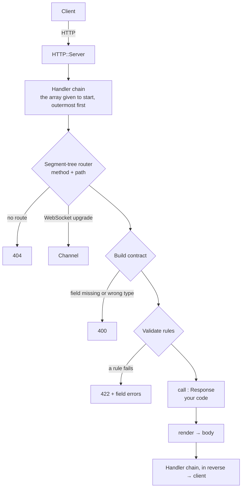

# Azu Web Framework Overview


Azu is a strongly typed web framework for Crystal. Every endpoint declares the request contract it accepts and the response it returns: the compiler checks the types, and Azu validates each request against its contract before your code runs. Routing is a tree of path segments, and WebSocket channels, pub/sub, presence and Spark live views are built in.


---

## Quickstart: The Minimal Type-Safe Endpoint

Azu replaces untyped params hashes with explicit **Request Contracts** and **Response Objects**.


```crystal
require "azu"

# 1. Request contract: typed fields, built from the query string, form or JSON body
struct HelloRequest
  include Azu::Request

  getter name : String = "World"
end

# 2. Response object: turns data into the body
struct HelloResponse
  include Azu::Response

  def initialize(@name : String)
  end

  def render : String
    "Hello, #{@name}!"
  end
end

# 3. Endpoint: accepts a HelloRequest, must return a HelloResponse
struct HelloEndpoint
  include Azu::Endpoint(HelloRequest, HelloResponse)

  get "/hello"

  def call : HelloResponse
    HelloResponse.new(hello_request.name)
  end
end

# 4. Configure and start the application
module MyApp
  include Azu

  configure do |config|
    config.port = 3000
    config.env = Azu::Environment::Development
  end
end

MyApp.start [
  Azu::Handler::Logger.new,
  Azu::Handler::Rescuer.new,
] of HTTP::Handler
```



```bash
crystal run src/hello.cr
curl "http://127.0.0.1:3000/hello"           # Hello, World!
curl "http://127.0.0.1:3000/hello?name=Ada"  # Hello, Ada!
```


- `hello_request` is the `HelloRequest` Azu built for this request. Reading a field the contract does not declare, or returning anything but a `HelloResponse`, is a compile error.
- The handler array is used exactly as given. `MyApp.start` with no argument uses the default stack: request id, logging, error pages, security headers and static files.
- The project setup (`shard.yml`, a test, templates) is in [Getting started](tutorials/getting-started.md). To have a project generated for you, see [Get started in 5 minutes](https://github.com/azutoolkit/azu#get-started-in-5-minutes).

## Design pillars

| Pillar | You write | Azu enforces | When |
|---|---|---|---|
| **Typed contracts** | `include Azu::Endpoint(Req, Res)` | `call` returns a `Res`. The request accessor, named after its type (`hello_request` for `HelloRequest`), has only the fields that type declares. | Compile time |
| **Validation** | `validate name, size: 2..30` | A missing or mistyped field answers `400`. A broken rule answers `422` with an [RFC 7807](https://www.rfc-editor.org/rfc/rfc7807) document listing each failing field. Either way `call` never runs. | Every request, before `call` |
| **Segment-tree routing** | `get "/users/:id"`, or `app.routes { ... }` | Static, `:param` and `*wildcard` segments, plus `scope` and `mount`. Methods and paths must match exactly, and a duplicate route fails at boot. A static route is found without allocating, and there is no path cache to fill. | Boot and every request |
| **Spark live views** | `Azu::Spark::Component` with `prop`, `state`, `event def` | The browser can trigger only `event def` methods, and their arguments arrive as the declared types. Joining needs a signed, expiring token. The server sends back only the HTML that changed. | Every event |
| **Opt-in extras** | `require "azu/dev"`, `"azu/cql"`, `"azu/testing"` | `require "azu"` alone does not load them. Core reaches optional subsystems through `Azu::Instrumentation`, which costs one nil check when nothing subscribes. | Compile time |

Details: [Endpoint](reference/api/endpoint.md), [Request](reference/api/request.md), [Validate requests](how-to/validation/validate-requests.md), [Router](reference/api/router.md), [Spark live views](explanation/spark-live-views.md), [Performance design](explanation/architecture/performance-design.md). This page has no speed figures. The reproducible suite and its method are in [Benchmarks](https://github.com/azutoolkit/azu/blob/master/benchmark/README.md).

## Request lifecycle



Step by step, with a program that prints the order: [Request lifecycle](explanation/architecture/request-lifecycle.md). Components and the handler chain: [Architecture overview](explanation/architecture/overview.md).

## Contracts vs params hashes

```crystal
struct SignupRequest
  include Azu::Request

  getter name : String
  getter age : Int32

  validate name, size: 2..30, message: "must be 2 to 30 characters"
  validate age, gte: 18, message: "must be 18 or older"
end
```

| Situation | Untyped params hash | Azu contract (`SignupRequest`) |
|---|---|---|
| `age` is missing | `nil`, or an exception where the code reads it | `400` `Missing required property: 'age'.` before `call` |
| `age=abc` (form) or `"age": "abc"` (JSON) | A conversion you write, in every handler | `400` before `call` |
| `name=A&age=12` | Checks you write and keep in sync | `422` with `errors: {name: [...], age: [...]}` before `call` |
| `age` used as a number | `params["age"].to_i` at each use | `signup_request.age` is an `Int32` |
| Misspelled field in your code | `nil` at runtime | Compile error |
| API description | Written and maintained by hand | `Azu::OpenAPI` builds an OpenAPI 3.1 document from the contracts ([OpenAPI](reference/api/openapi.md)) |
| Tests | Raw HTTP requests | `Azu::Testing::Client` drives the real handler chain and router without a socket ([Testing](reference/api/testing.md)) |

Error bodies follow the `Accept` header: problem JSON, JSON, HTML or text. See [Handle validation errors](how-to/validation/handle-validation-errors.md) and [Contracts](explanation/concepts/contracts.md).

## Choosing a real-time primitive

| Primitive | Transport | State lives in | Across nodes | Use it for |
|---|---|---|---|---|
| [`Azu::Channel`](reference/api/channel.md) | WebSocket, both directions | One instance per connection | Broadcast through `Azu::PubSub::Redis` | Your own message protocol: chat, games, device feeds |
| [`Azu::PubSub`](how-to/real-time/broadcast-messages.md) | In process. `PubSub::Redis` between processes | Nothing: it is a topic bus | `PubSub::Redis`. Messages published while a subscriber reconnects are lost | Fan-out to channels and components |
| [`Azu::Presence`](reference/api/presence.md) | Join and leave diffs on `presence:<topic>`, via PubSub | `Store::Memory`, or Redis hashes | `Store::Redis`. A dead node's users leave after `ttl` | Who is in a room or document right now |
| [`Azu::Response::EventStream`](reference/api/streaming.md) (SSE) | HTTP, server to browser | The stream's fiber | `EventSource` reconnects to any instance with `Last-Event-ID` | Notifications, progress, feeds |
| [`Azu::Spark::Component`](explanation/spark-live-views.md) | WebSocket. Browser events in, HTML diffs out | The component, on the server, per connection | State marked `persist: true` comes back from a signed snapshot on reconnect | Interactive server-rendered UI without writing JavaScript |

A Spark live view, complete:

```crystal
class Counter < Azu::Spark::Component
  mountable

  prop label : String = "Clicks"
  state count : Int32 = 0

  event def increment(by : Int32 = 1) : Nil
    self.count += by
  end

  def render
    div class: "counter" do
      h2 "#{label}: #{count}"
      button "+1", **spark_click(:increment)
      button "+10", **spark_click(:increment, by: 10)
    end
  end
end
```

Multi-node setup: [Real-time across processes](how-to/deployment/scale-horizontally.md#real-time-across-processes). Wire protocol, reconnects and patching: [Spark client](reference/spark-client.md).

## Documentation map

<table data-view="cards"><thead><tr><th></th><th></th><th data-hidden data-card-target data-type="content-ref"></th></tr></thead><tbody>
<tr><td><strong>Tutorials</strong></td><td>Learn by building, in order. Start with a validated endpoint in about 15 minutes.</td><td><a href="tutorials/getting-started.md">getting-started.md</a></td></tr>
<tr><td><strong>How-to guides</strong></td><td>One task per page: endpoints, validation, templates, real-time, data, deployment.</td><td><a href="how-to/endpoints/create-endpoint.md">create-endpoint.md</a></td></tr>
<tr><td><strong>Reference</strong></td><td>Exact signatures, options, defaults and behavior.</td><td><a href="reference/api/endpoint.md">endpoint.md</a></td></tr>
<tr><td><strong>Concepts</strong></td><td>Why Azu works the way it does, and how the parts fit.</td><td><a href="explanation/architecture/overview.md">overview.md</a></td></tr>
</tbody></table>

Also: [Examples](examples.md) (runnable apps in `playground/`) · [Everything in the box](explanation/features.md) (every feature, with its guide) · [FAQ and troubleshooting](faq.md) · [Migrate to 0.6](how-to/migrate-to-0.6.md) · [Breaking changes](reference/breaking-changes.md)

## Tutorials

1. [Getting started](tutorials/getting-started.md): an endpoint with a validated contract, a page, a test and the dev dashboard, in about 15 minutes.
2. [Building a user API](tutorials/building-a-user-api.md): a complete JSON CRUD API.
3. [Working with databases](tutorials/working-with-databases.md): CQL models, migrations and queries.
4. [Adding WebSockets](tutorials/adding-websockets.md): a chat channel with pub/sub.
5. [Building live components](tutorials/building-live-components.md): server-rendered views that update in place.
6. [Testing your app](tutorials/testing-your-app.md): endpoints, contracts, channels and components.
7. [Deploying to production](tutorials/deploying-to-production.md): configuration, secrets and a running service.

## How-to guides

| Area | Guides |
|---|---|
| Endpoints | [Create an endpoint](how-to/endpoints/create-endpoint.md) · [Handle parameters](how-to/endpoints/handle-parameters.md) (path, query, form, JSON) · [Return different formats](how-to/endpoints/return-different-formats.md) |
| Apps and APIs | [Mount an app under a prefix](how-to/apps/mount-an-app.md) · [Run several apps in one process](how-to/apps/run-several-apps.md) · [Publish your OpenAPI document](how-to/api/publish-openapi.md) |
| Validation | [Validate requests](how-to/validation/validate-requests.md) · [Handle validation errors](how-to/validation/handle-validation-errors.md) |
| Files | [Handle file uploads](how-to/file-handling/handle-file-uploads.md) · [Validate file types](how-to/file-handling/validate-file-types.md) |
| Errors | [Handle errors gracefully](how-to/errors/handle-errors-gracefully.md) · [Create custom errors](how-to/errors/create-custom-errors.md) · [Debug exceptions](how-to/errors/debug-exceptions.md) |
| Middleware | [Create custom middleware](how-to/middleware/create-custom-middleware.md) · [Add logging](how-to/middleware/add-logging.md) · [Use sessions](how-to/middleware/use-sessions.md) · [Protect forms and APIs](how-to/middleware/protect-forms-and-apis.md) |
| Templates | [Render HTML templates](how-to/templates/render-html-templates.md) · [Enable hot reload](how-to/templates/enable-hot-reload.md) · [Localize your app](how-to/templates/localize-your-app.md) |
| Real-time | [Create a WebSocket channel](how-to/real-time/create-websocket-channel.md) · [Broadcast messages](how-to/real-time/broadcast-messages.md) · [Build a live component](how-to/real-time/build-live-component.md) · [Stream server-sent events](how-to/real-time/stream-server-sent-events.md) |
| Database | [Define a schema](how-to/database/define-schema.md) · [Create models](how-to/database/create-models.md) · [Run migrations](how-to/database/run-migrations.md) · [Query data](how-to/database/query-data.md) · [Handle transactions](how-to/database/handle-transactions.md) |
| Caching and jobs | [Set up a memory cache](how-to/caching/setup-memory-cache.md) · [Set up a Redis cache](how-to/caching/setup-redis-cache.md) · [Run background jobs](how-to/jobs/background-jobs.md) |
| Testing | [Test endpoints](how-to/testing/test-endpoints.md) · [Test WebSockets](how-to/testing/test-websockets.md) |
| Performance | [Optimize endpoints](how-to/performance/optimize-endpoints.md) · [Optimize database queries](how-to/performance/optimize-database-queries.md) · [Monitor performance in development](how-to/performance/monitor-performance.md) · [Use the dev dashboard](how-to/performance/use-dev-dashboard.md) |
| Deployment | [Configure production](how-to/deployment/configure-production.md) · [Deploy with Docker](how-to/deployment/deploy-with-docker.md) · [Scale horizontally](how-to/deployment/scale-horizontally.md) · [Shut down gracefully](how-to/deployment/graceful-shutdown.md) |
| Upgrading | [Migrate to 0.6](how-to/migrate-to-0.6.md): from the global `configure` style to `Azu::App` |

## Reference

| Area | Pages |
|---|---|
| Core API | [App](reference/api/app.md) · [Router](reference/api/router.md) · [Handler pipeline](reference/api/handler-pipeline.md) · [Session adapter](reference/api/session-adapter.md) · [Endpoint](reference/api/endpoint.md) · [Request](reference/api/request.md) · [Response](reference/api/response.md) |
| HTTP | [Content negotiation](reference/api/content-negotiation.md) · [Streaming and SSE](reference/api/streaming.md) · [OpenAPI](reference/api/openapi.md) · [Built-in handlers](reference/handlers/built-in.md) · [Error types](reference/errors/error-types.md) |
| Real-time | [Channel](reference/api/channel.md) · [PubSub](reference/api/pubsub.md) · [Presence](reference/api/presence.md) · [Component](reference/api/component.md) · [Spark client and reconnects](reference/spark-client.md) · [Spark benchmarks](reference/spark-benchmarks.md) |
| Configuration | [Configuration options](reference/configuration/options.md) · [Spark configuration](reference/configuration/spark.md) · [Environments](reference/configuration/environments.md) · [`Azu::Env`](reference/configuration/env.md) |
| Templates | [Templates and Renderable](reference/templates/renderable.md) · [Template engine](reference/templates/engine.md) · [Template helpers](reference/templates/helpers.md) |
| Data and caching | [Cache](reference/api/cache.md) · [Redis](reference/api/redis.md) · [Instrumentation](reference/api/instrumentation.md) · [Clock](reference/api/clock.md) · [CQL bridge](reference/api/cql-bridge.md) · [Database dashboard](reference/database-dashboard.md) · [CQL API](reference/database/cql-api.md) · [Query methods](reference/database/query-methods.md) · [Validations](reference/database/validations.md) |
| Testing | [Testing](reference/api/testing.md) |
| Development | [Dev tools](reference/dev/azu-dev.md) (`azu/dev`) · [Database dashboard](reference/database-dashboard.md) |
| Releases | [Breaking changes](reference/breaking-changes.md): what changed in each version and how to adapt |

## Concepts

| Topic | Pages |
|---|---|
| The whole box | [Everything in the box](explanation/features.md) |
| Architecture | [Architecture overview](explanation/architecture/overview.md) · [Apps, configuration and scope](explanation/architecture/apps-and-scope.md) · [Request lifecycle](explanation/architecture/request-lifecycle.md) · [Type safety](explanation/architecture/type-safety.md) · [Performance design](explanation/architecture/performance-design.md) · [Request-path performance](explanation/request-path-performance.md) |
| Building blocks | [Endpoints](explanation/concepts/endpoints.md) · [Contracts](explanation/concepts/contracts.md) · [Middleware](explanation/concepts/middleware.md) · [Real-time](explanation/concepts/real-time.md) · [Components](explanation/concepts/components.md) · [Spark live views](explanation/spark-live-views.md) |

## Contributing

- [Development setup](contributing/setup.md) · [Code standards](contributing/standards.md) · [Documentation style](contributing/docs-style.md) · [Roadmap](contributing/roadmap.md)
- [Benchmarks](https://github.com/azutoolkit/azu/blob/master/benchmark/README.md): how Azu is measured against other frameworks.
