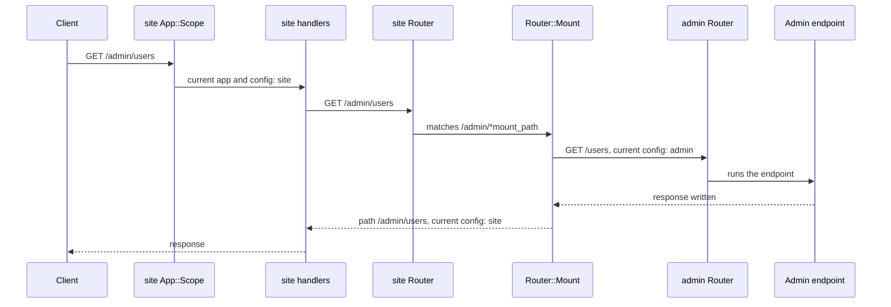

# Apps, configuration and scope

## An app is a value

An `Azu::App` is a `Configuration` (the settings and the router in it), a handler chain and a lifecycle: `start`,
`stop`, the requests in flight and the open WebSockets. Nothing in it is global, so a process can hold several: two
servers on two ports, one app mounted inside another, or an app built for one spec and dropped afterwards.

`Azu::CONFIG` is a `Configuration` built when `azu` is required, and `Azu::App.default` is the app built around
it. The `include Azu` facade is a thin layer over the two: `configure` yields `Azu::CONFIG`, and `MyApp.start` is
`Azu::App.default.start`. The endpoint verb macros (`get "/users"` in an endpoint body) register on
`Azu::App.default` as well, so an application with one app never has to name one. The facade is the supported way
to write that application; `Azu::App.new` is for what the facade cannot say: a second app, a mount, a test with its
own configuration.

A new app's configuration starts from the same environment variables as `Azu::CONFIG` (`PORT`, `HOST`,
`CRYSTAL_ENV`, ...). Two apps differ in what is set on them afterwards.

## How code finds its app

Much of what runs during a request has no app to ask: a template rendered from `render`, `Azu.cache`, the body size
limit applied while parameters are parsed, the error body of a `422`. An endpoint's `call` takes no arguments, so
there is no place to pass an app down. That code calls `Azu.current_config` instead, which answers with the
configuration of the app serving the current fiber, and with `Azu::CONFIG` when no app is.

The answer is kept per fiber, since each request runs in its own fiber. `Azu::App::Scope` sets it: `App#chain` puts
this handler in front of every chain of the app, so it is never in the list you pass to `start`. For each request it

- counts the request as in flight, which is what `stop` waits for;
- runs the rest of the chain with the app and its configuration recorded for the fiber (`Azu.current_app`,
  `Azu.current_config`), and puts back what was recorded before when the chain returns;
- answers `503` with `Retry-After: 1`, without running the chain, once the app is shutting down.

A fiber started with `spawn` does not inherit the record: it starts with the global configuration and no app.
`Azu.spawn_scoped` starts one that keeps both, for work that outlives the request, such as a timer. A WebSocket
outlives the chain too, so the upgrade captures the app and its configuration, and the channel's callbacks run with
them. `Azu.with_config(config) { ... }` sets the configuration alone for a block; specs use it, and so does a mount.

The record lives in a hash guarded by a mutex: a request writes it when it enters the scope and when it leaves, and
each `Azu.current_config` call reads it.

## What belongs to an app

| Each app has its own | Shared by every app in the process |
| --- | --- |
| Router and routes | The routes of the endpoint verb macros and of a class-level `Channel.ws`, which go to `Azu::App.default` |
| Templates: directories, hot reload, the compiled set | The template helper registry, including the generated `link_to_*` and `form_for_*` helpers |
| `env`, `log`, `cache`, `error_format`, `format_parameter`, `session_adapter` | The i18n tables: building an app's server applies the `i18n` settings that differ from the defaults, and the last app built wins |
| `upload`, `websocket` and `spark` settings | PubSub backend, Spark connections, the default Presence tracker, the Redis pools, `QueryStore` |
| Handler chain, server, requests in flight, open WebSockets, shutdown signal | The SIGINT/SIGTERM trap, `Azu.on_shutdown` hooks and `Azu.shutdown`, the async log pipeline, the `Handler::CSRF.exempt` paths |

Handlers sit between the two. One that reads a setting while it serves reads the app serving the request:
`Logger`, `SimpleLogger` and `Throttle` without `log:`, and `Rescuer` deciding whether a `500` shows the exception's
message (development only). A default taken when the handler is built comes from `Azu::CONFIG`: `Static`'s
`cache_max_age` and the `log:` of the `azu/dev` handlers. `default_handlers` passes the app's own `cache_max_age`.

## What a mount is

A mount is a route, not a server. `mount admin, at: "/admin"` registers one `Azu::Router::Mount` on the parent's
router for `/admin` and `/admin/*mount_path`, for every method and for WebSocket upgrades. When a request matches it,
the mount removes the prefix from the path, runs the admin app's router with `Azu.with_config(admin.config)`, and puts
the path back.

What follows from that:

- **One chain.** Only the parent's handlers run. The admin app is not started, so its own handlers, if it has any,
  run only on a server of its own.
- **One current app.** `Azu.current_app` stays the parent: the request counts as the parent's, the parent's
  shutdown refuses it with `503`, and a socket accepted through the mount is closed with `1001` when the parent stops.
- **The configuration of the mounted app, inside the mount only.** Templates, cache, WebSocket settings and the
  errors the admin app answers itself (its `404`, a contract's `400` and `422`) follow `admin.config`. An exception
  that escapes the admin endpoint is rendered by the parent's `Rescuer`, after the mount has put the parent's
  configuration and the full path back.
- **No boot of its own.** `start` compiles the templates of the app it starts and applies its i18n settings. The
  mounted app's templates (with hot reload off) are compiled on their first render unless you call `admin.prepare`,
  and its i18n settings are not applied.
- **Links.** `Endpoint.path` adds the prefix the app is mounted at (`Router#mount_prefix`, which adds up through
  nested mounts), so a link built inside the admin app is right. What the admin app reads from the request has no
  prefix: `current_path` in its templates is `/users`.
- **Introspection.** `route_info` lists the mount's own routes, with `Azu::Router::Mount` as the handler, and not the
  admin app's; the OpenAPI document walks into the mount and lists them below `/admin`.

An app is mounted once, because its links carry the one prefix it is mounted at; a second `mount` of it raises.

## See also

- [App](../../reference/api/app.md)
- [Mount an app under a prefix](../../how-to/apps/mount-an-app.md)
- [Run several apps in one process](../../how-to/apps/run-several-apps.md)
- [Request lifecycle](request-lifecycle.md)
