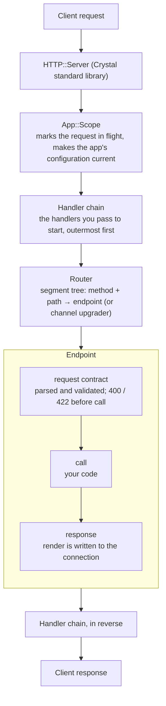
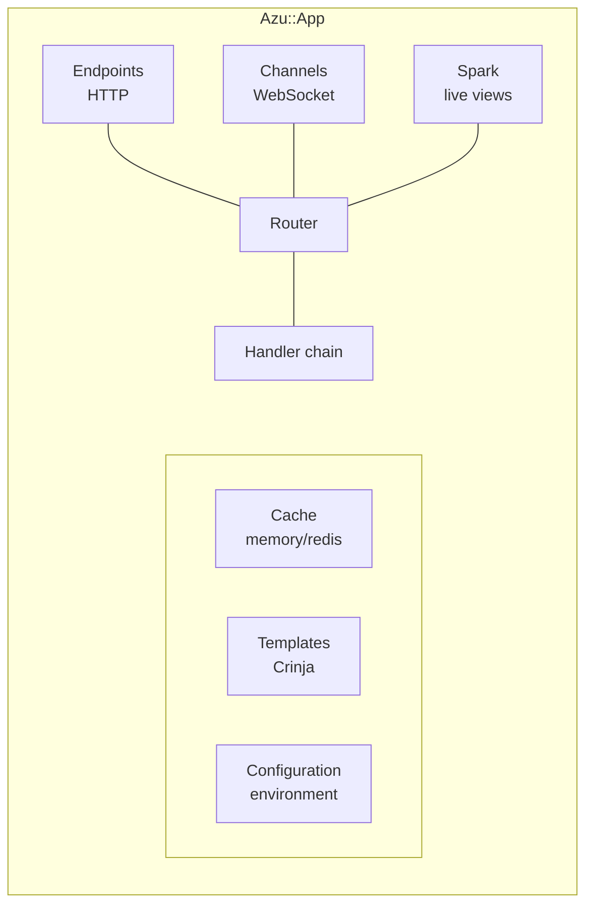
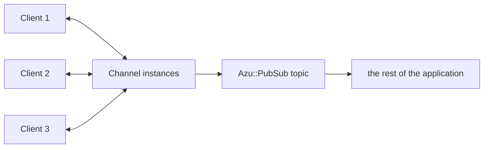
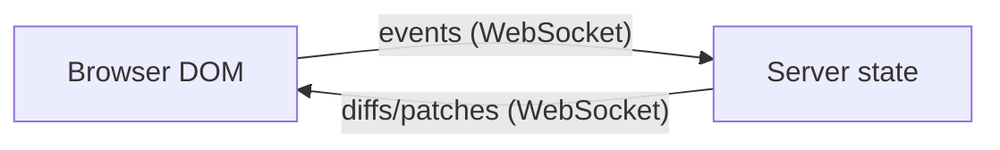

# Architecture overview

## Design philosophy

Azu is a web framework for Crystal. Its design choices:

1. **Type safety** - request and response types are part of an endpoint's declaration, and the compiler checks the
   code that uses them.
2. **Contracts** - a request type states what an endpoint accepts and is enforced before the endpoint runs.
3. **Small core, explicit stack** - the handler chain is an array you can read; optional subsystems are opt-in
   requires (`azu/cql`, `azu/dev`) and cost nothing when not required.
4. **Real-time built in** - WebSocket channels, a pub/sub bus and server-rendered live components (Spark).

## Core components

### An app is a value

An `Azu::App` bundles a `Configuration` and a `Router`. The endpoint macros and the `include Azu` facade (`MyApp.start`) use the
default app, `Azu::App.default`, which wraps the global `Azu::CONFIG`; you can build more (`Azu::App.new`) and
`mount` one below a prefix of another, each with its own configuration. `app.server(handlers)` returns the
`HTTP::Server` that serves it.

### Request/response cycle



[Request Lifecycle](request-lifecycle.md) walks through each step with a program that prints the order.

### Components



## Type-safe request handling

An endpoint names its request and response types, and its `call` returns the response type:

```crystal
require "azu"

struct CreateUserRequest
  include Azu::Request

  getter name : String
  getter email : String

  def initialize(@name = "", @email = "")
  end

  validate name, presence: true
  validate email, presence: true
end

struct UserResponse
  include Azu::Response

  def initialize(@name : String)
  end

  def render
    {name: @name}.to_json
  end
end

struct CreateUserEndpoint
  include Azu::Endpoint(CreateUserRequest, UserResponse)
  #                     ↑                  ↑
  #                     input contract     output type

  post "/users"

  def call : UserResponse
    UserResponse.new(create_user_request.name)
  end
end
```

The compiler checks that `call` returns a `UserResponse` and that `create_user_request` has the fields of
`CreateUserRequest`. At run time a request that breaks the contract is answered with `422` before `call`.

## Handler chain

Handlers are `HTTP::Handler`s that wrap every request. The chain is an array, outermost first:

```crystal
require "azu"

module MyApp
  include Azu
end

class AuthHandler
  include HTTP::Handler

  def call(context : HTTP::Server::Context)
    call_next(context)
  end
end

MyApp.start [
  Azu::Handler::RequestId.new,
  Azu::Handler::Logger.new,
  Azu::Handler::Rescuer.new,
  AuthHandler.new,
] of HTTP::Handler
```

`MyApp.start` without an argument serves the default stack (`RequestId`, `Logger`, `Rescuer`, `SecurityHeaders`,
`Static`). The router is always the last link, so endpoints are not listed. Each handler can act before the rest of
the chain, change the response after it, or answer on its own and stop the chain. See
[the middleware concept](../concepts/middleware.md).

## Routing

The router is a tree of path segments (`Azu::Router::Tree`). Routes come from the endpoint macros (`get "/users/:id"`) or
from an app's `routes` block (`get`, `post`, ..., `ws`, `scope`, `mount`). It supports

- static and `:param` segments, with the parameters available as `params`,
- one route per HTTP method (and `ws` for WebSockets),
- `POST` with `_method` or `X-HTTP-Method-Override` handled as `PUT`, `PATCH` or `DELETE`,
- prefixes: `scope "/api"` prefixes the routes inside it, `mount app, at: "/admin"` serves another app below a path.

An unmatched request is answered with a `404` error response by the router itself.

## Real-time architecture

### WebSocket channels

A channel class (`ws "/chat"`) handles one WebSocket connection per instance, with callbacks for connect, message,
binary, ping, pong and close. Channels talk to each other, and to the rest of the application, through topics of
`Azu::PubSub`:



### Spark live views

Spark components keep their state on the server and send HTML patches over a WebSocket:



See [Spark live views](../spark-live-views.md).

## Module structure

```text
Azu
├── App            Configuration + Router, server, graceful shutdown
├── Configuration  Environment-driven settings
├── Router         Segment-tree routing, scopes, mounts
├── Routable       What the router dispatches to
├── Endpoint       Request handling
├── Request        Input contracts and validation
├── Response       Output contracts and error types
├── Handler        Middleware (RequestId, Logger, Rescuer, Static, CORS, CSRF, ...)
├── Channel        WebSocket channels
├── PubSub         Topics, in memory or over Redis
├── Spark          Live views (Spark::Component)
├── Component      Static markup components, with Markup
├── Cache          Memory, Redis and null stores
├── Templates      Crinja rendering
├── Helpers        Template helpers and i18n
├── Instrumentation  Hooks for optional tooling
└── RequestContext   The request being served, per fiber
```

Two directories are opt-in and are not loaded by `require "azu"`: `azu/cql` (the CQL bridge, query telemetry) and
`azu/dev` (the dashboard, performance monitor and profiler).

## Performance

What the code does for speed (the router, the handlers, the cache) and what it measurably costs is on one page:
[Performance Design](performance-design.md).

## See also

- [Request Lifecycle](request-lifecycle.md)
- [Type Safety](type-safety.md)
- [Performance Design](performance-design.md)
