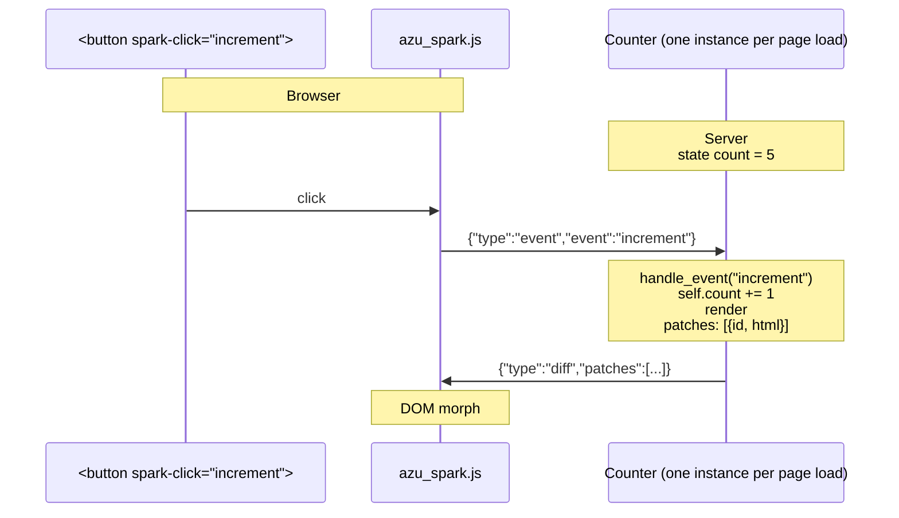
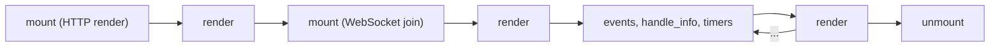

# Components

For the API see the
[Component Reference](../../reference/api/component.md); for the architecture, wire protocol and
security model see [Spark Live Views](../spark-live-views.md).

## What are components?

Azu has two kinds of components, and the difference is whether the browser can talk back.

**Static components** (`Azu::Component`) are a piece of HTML written in Crystal. You build them, call
`render`, and get a `String`. Nothing stays on the server afterwards.

```crystal
class Badge
  include Azu::Component

  def initialize(@label : String)
  end

  def content
    span @label, class: "badge"
  end
end

Badge.new("new").render # => "<span class='badge'>new</span>"
```

**Live components** (`Azu::Spark::Component`) keep state on the server. They:

- hold typed `state` and read-only `prop`s,
- render HTML,
- respond to browser events declared with `event def`,
- push the HTML that changed to the browser over a WebSocket.

```crystal
class Counter < Azu::Spark::Component
  mountable

  state count : Int32 = 0

  event def increment : Nil
    self.count += 1
  end

  def render
    div do
      span "Count: #{count}"
      button "+", **spark_click(:increment)
    end
  end
end
```

## How live components work



1. `Azu::Spark.render(Counter)` puts the component's HTML in the page, together with a signed token.
2. The client script opens one WebSocket per page and joins every component with its token. The
   server mounts a fresh instance owned by that connection.
3. A click sends an `event` frame. Names and parameter types of every `event def` form a
   compile-time dispatch table, so the browser can invoke nothing else.
4. The handler changes state, the component renders again, and the server sends a `diff` with the new
   HTML of the components that changed.
5. The client morphs the DOM with the new HTML.

## Lifecycle

```crystal
class Feed < Azu::Spark::Component
  mountable

  state items : Array(String) = [] of String

  def mount(socket : Azu::Spark::Socket, params : Azu::Spark::Params) : Nil
    self.items = ["loaded for #{socket.connected? ? "the socket" : "the page"}"]
    socket.subscribe("feed")
  end

  def handle_info(message : Azu::PubSub::Message, socket : Azu::Spark::Socket) : Nil
    self.items = (items + [message.payload]).last(10)
  end

  def unmount(socket : Azu::Spark::Socket) : Nil
    # Subscriptions and timers are already cancelled; release anything else here.
  end

  def render
    ul { items.each { |item| li item } }
  end
end
```



`mount` runs twice: once while the page is rendered over HTTP (`socket.connected?` is `false`, so
`subscribe` and timers do nothing yet) and again when the browser joins. Keep it idempotent.

## State

`state` is owned by the server. Assigning a different value marks the component dirty:

```crystal
class Settings < Azu::Spark::Component
  mountable

  state theme : String = "light"
  state compact : Bool = false

  event def reset : Nil
    assign theme: "light", compact: false
  end

  event def toggle_compact : Nil
    self.compact = !compact
  end

  def render
    div class: "settings #{theme}" do
      span "compact: #{compact}"
      button "Toggle", **spark_click(:toggle_compact)
      button "Reset", **spark_click(:reset)
    end
  end
end
```

Assigning a value equal to the current one does nothing, so no render is scheduled. By default state
is lost when the connection ends. `state count : Int32 = 0, persist: true` stores the value in a
signed snapshot that the browser sends back when it reconnects (it must be JSON serializable and not
secret). `props` never change on their own: the page or the parent supplies them.

## Events

Bindings turn DOM events into server events. They return `spark-*` attributes that you splat into a tag:

```crystal
class Todos < Azu::Spark::Component
  mountable

  state todos : Array(String) = [] of String
  state draft : String = ""

  event def type_draft(value : String) : Nil
    self.draft = value
  end

  event def add : Nil
    self.todos = todos + [draft] unless draft.blank?
    self.draft = ""
  end

  event def remove(index : Int32) : Nil
    remaining = todos.dup
    remaining.delete_at(index) if index < remaining.size
    self.todos = remaining
  end

  def render
    div do
      form(**spark_submit(:add)) do
        input **spark_change(:type_draft, debounce: 200), type: "text", name: "value", value: draft
        button "Add", type: "submit"
      end
      ul do
        todos.each_with_index do |todo, index|
          li do
            span todo
            button "x", **spark_click(:remove, index: index)
          end
        end
      end
    end
  end
end
```

Event parameters come from the payload by name (`name="value"` on the input, `index: index` on the
button) and are converted to the declared type. A payload that does not fit is rejected before the
handler runs and the component state is untouched. A parameter typed as an `Azu::Request` receives the
whole form payload, so a submitted form can be validated with the same contract an endpoint uses.

## Updates are targeted

The server tracks which components changed. Only those render again and only their HTML is sent, so a
page with twenty components pays for the one that was clicked. Children (`live Child, key: ..., ...`)
are components of their own: changing a child re-renders the child, not its parent.

You can check this in a test: `Azu::Spark::Testing` records every patch.

```crystal
require "spec"

class Item < Azu::Spark::Component
  prop name : String
  state clicks : Int32 = 0

  event def click : Nil
    self.clicks += 1
  end

  def render
    button "#{name}: #{clicks}", **spark_click(:click)
  end
end

class Page < Azu::Spark::Component
  state title : String = "Items"

  def render
    div do
      h1 title
      live Item, key: "a", name: "A"
      live Item, key: "b", name: "B"
    end
  end
end

describe Page do
  it "re-renders only the child that changed" do
    Azu::Spark::Testing.mount(Page) do |view|
      child = view.components(Item).first
      patches_before = view.patches.size
      view.trigger("click", target: child)
      (view.patches.size - patches_before).should eq 1
      view.patches.last.id.should eq child.id
    end
  end
end
```

## Server-initiated updates

A live component is not limited to reacting to clicks. `handle_info` receives PubSub broadcasts, timers
and messages the component sends itself, and the component renders afterwards.

```crystal
class Clock < Azu::Spark::Component
  mountable

  state now : String = Time.utc.to_s("%H:%M:%S")

  def mount(socket : Azu::Spark::Socket, params : Azu::Spark::Params) : Nil
    socket.every(1.second, "tick")
  end

  def handle_info(message : Azu::PubSub::Message, socket : Azu::Spark::Socket) : Nil
    self.now = Time.utc.to_s("%H:%M:%S")
  end

  def render
    span now
  end
end
```

Anything in your application can reach every connected browser through the topic bus:

```crystal
Azu::PubSub.broadcast("feed", "a new item") # every Feed component receives it in handle_info
```

## Communication between components

- **Parent to child:** props. A parent passes new props on every render; the child re-renders only when
  one differs.
- **Child to parent:** a binding can address another component with `target: :parent` or `target: :root`,
  and the event is handled by an `event def` of that component.
- **Anywhere to anywhere:** `socket.broadcast(topic, payload)` and `socket.subscribe(topic)`. This also
  reaches other users' connections and, with the Redis PubSub backend, other processes.

## When to use components

Good fits: interactive forms with live validation, search and filtering, dashboards, chat, notifications,
dynamic lists.

Prefer plain endpoints for static content, API responses, file downloads and simple forms that redirect.
Each mounted component costs memory on the server for as long as the page is open (a connection owns at
most `Azu::Spark.config.max_components`).

## See also

- [Real-time concepts](real-time.md)
- [Component Reference](../../reference/api/component.md)
- [How to build a live component](../../how-to/real-time/build-live-component.md)
