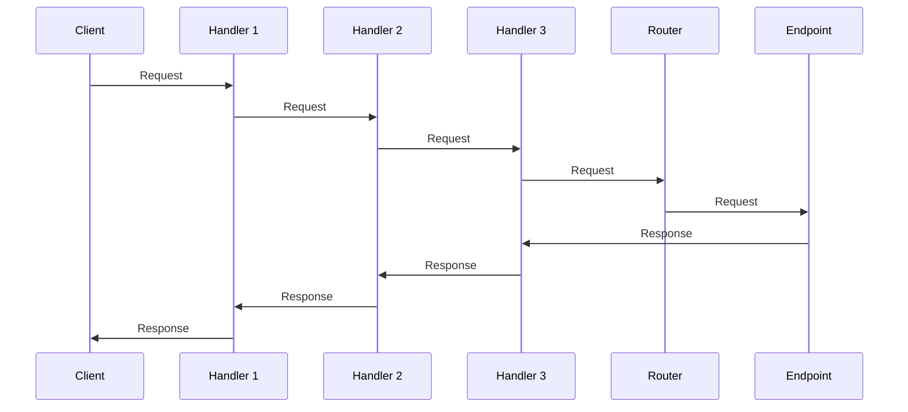

# Middleware

## What is middleware?

A handler is an object that sees every request before the router does and every response after the endpoint
has produced it. Handlers are plain Crystal `HTTP::Handler`s, so anything written for the standard library's
`HTTP::Server` works in Azu too. They form a chain:



The router is always the last link. Endpoints are not part of the handler array: they are registered on an
app (`get "/users"` in an endpoint, or `app.routes { ... }`) and found by the router.

## The handler pattern

A handler includes `HTTP::Handler` and implements `call(context)`:

```crystal
class TimingHandler
  include HTTP::Handler

  def call(context : HTTP::Server::Context)
    start = Time.instant
    call_next(context)
    elapsed = Time.instant - start
    context.response.headers["X-Response-Time"] = "#{elapsed.total_milliseconds.round(2)}ms"
  end
end
```

`call_next(context)` passes control to the next handler (and, after the last one, to the router). The code before
it runs on the way in, the code after it on the way out:

```crystal
class TraceHandler
  include HTTP::Handler

  def initialize(@name : String, @steps : Array(String))
  end

  def call(context : HTTP::Server::Context)
    @steps << "before #{@name}"
    call_next(context)
    @steps << "after #{@name}"
  end
end
```

With `TraceHandler.new("A", steps)` followed by `TraceHandler.new("B", steps)`, one request records
`before A, before B, after B, after A`.

### Headers after `call_next`

A response head is sent the moment the body starts to leave the server: when a response is large, flushed or
streamed. `TimingHandler` above sets its header after `call_next`, which works for a small response and silently
loses the header once the body reaches 32 KiB (the size of the standard library's output buffer). Set headers you can
compute up front (a request id, a security header) before `call_next`, and treat headers computed afterwards, like a
timing, as best effort.

## Handler chain

`MyApp.start` (a module that includes `Azu`), like `Azu::App#start`, takes the chain as an array, outermost handler first:

```crystal
module MyApp
  include Azu
end

class AuthHandler
  include HTTP::Handler

  def call(context : HTTP::Server::Context)
    call_next(context)
  end
end

MyApp.start [
  Azu::Handler::RequestId.new,
  Azu::Handler::Logger.new,
  Azu::Handler::Rescuer.new,
  AuthHandler.new,
] of HTTP::Handler
```

An array you pass is used exactly as given and nothing is added to it. `MyApp.start` without an argument serves
`Azu::App#default_handlers`: `RequestId`, `Logger`, `Rescuer`, `SecurityHeaders` (HSTS follows `config.tls?`) and
`Static` serving `./public` with `fallthrough: true`. `Compression`, `HealthCheck`, `CORS`, `CSRF` and `Throttle`
are opt-in.


A handler stores the next handler of the chain it is in, so one instance can be in one chain only. Reusing it
for a second server raises `ArgumentError: ... is already part of a chain; use one handler instance per server`.
Build fresh instances for every app or spec.


## Use cases

### Cross-cutting concerns

Handlers are ideal for concerns that span many endpoints. Azu ships these (see the
[handler reference](../../reference/handlers/built-in.md)):

| Concern | Handler |
|---------|---------|
| Request ids | `Azu::Handler::RequestId` |
| Request logging | `Azu::Handler::Logger` |
| Error pages | `Azu::Handler::Rescuer` |
| Security headers | `Azu::Handler::SecurityHeaders` |
| Static files | `Azu::Handler::Static` |
| Cross-origin requests | `Azu::Handler::CORS` |
| CSRF protection | `Azu::Handler::CSRF` |
| Rate limiting | `Azu::Handler::Throttle` |
| Compression | `Azu::Handler::Compression` |
| Health probes | `Azu::Handler::HealthCheck` |
| Forged forwarding headers | `Azu::Handler::IpSpoofing` |
| `Accept-Language` negotiation | `Azu::Handler::Locale` |

Authentication and authorization are application code: write a handler (below) or check in the endpoint.

### Request modification

A handler can change the request the endpoint sees. The request headers are the only channel an endpoint can read,
so a handler that passes information down must overwrite what the client sent, never trust it:

```crystal
class CurrentUserHandler
  include HTTP::Handler

  def call(context : HTTP::Server::Context)
    # Always overwrite or delete: a client can send X-User-ID itself.
    if token = context.request.headers["Authorization"]?
      context.request.headers["X-User-ID"] = token.lchop("Bearer ")
    else
      context.request.headers.delete("X-User-ID")
    end
    call_next(context)
  end
end
```

### Response modification

Add headers before `call_next` so they are sent whatever the endpoint does:

```crystal
class PoweredByHandler
  include HTTP::Handler

  def call(context : HTTP::Server::Context)
    context.response.headers["X-Powered-By"] = "Azu"
    call_next(context)
  end
end
```

(`Azu::Handler::SecurityHeaders` does this for the standard security headers, and leaves a header alone when
the application already set it.)

### Short-circuiting

Stop processing early by not calling `call_next`. Handlers after this one, and the router, never run:

```crystal
class ApiKeyHandler
  include HTTP::Handler

  def initialize(@key : String)
  end

  def call(context : HTTP::Server::Context)
    if context.request.headers["X-Api-Key"]? == @key
      call_next(context)
    else
      context.response.status_code = 401
      context.response.content_type = "application/json"
      context.response.print({error: "Unauthorized"}.to_json)
    end
  end
end
```

## Handler vs endpoint

### When to use handlers

- Applies to many routes
- Cross-cutting concern
- Modifies request or response metadata
- Needs to wrap endpoint execution

### When to use endpoints

- Specific business logic
- A single route
- Main request handling
- Produces the response body

## Handler composition

### Conditional handlers

Apply logic only to some requests and pass everything else straight through:

```crystal
class AdminOnlyHandler
  include HTTP::Handler

  def call(context : HTTP::Server::Context)
    if context.request.path.starts_with?("/admin") && context.request.headers["X-Admin"]? != "yes"
      context.response.status_code = 403
      return
    end

    call_next(context)
  end
end
```

### Handlers with state

A handler lives as long as the server, so its instance variables are shared by every request, including requests
running at the same time. Use `Atomic` or a `Mutex`:

```crystal
class MetricsHandler
  include HTTP::Handler

  getter count = Atomic(Int64).new(0)

  def call(context : HTTP::Server::Context)
    @count.add(1)
    call_next(context)
  end
end
```

### Configurable handlers

Accept configuration in the constructor:

```crystal
class MaintenanceHandler
  include HTTP::Handler

  def initialize(@enabled : Bool = false, @retry_after : Time::Span = 5.minutes)
  end

  def call(context : HTTP::Server::Context)
    return call_next(context) unless @enabled

    context.response.status_code = 503
    context.response.headers["Retry-After"] = @retry_after.total_seconds.to_i.to_s
  end
end
```

## Ordering best practices

Order is behaviour:

- **`Rescuer` only catches what is thrown inside it.** A handler placed before `Rescuer` that raises
  `Azu::Response::Forbidden` produces the bare `500 Internal Server Error` of the standard library; placed after
  it, the same error becomes a `403` with Azu's error body.
- **`Logger` outside `Rescuer` logs the final status.** The log line of a request that raised says `Status: 500`.
  Inside `Rescuer` it would see the exception instead.
- **`RequestId` first** so everything after it (logs, error pages, `Azu::RequestContext`) carries the id. A
  request id sent by the client is kept; otherwise one is generated.
- **Authentication after `Static`** if public files must stay reachable, before everything that must be protected.
- **`CORS` before `CSRF` and authentication**, so preflight requests (which carry no credentials) are answered.

A reasonable full stack:

```crystal
module MyApp
  include Azu
end

MyApp.start [
  Azu::Handler::RequestId.new,
  Azu::Handler::Logger.new,
  Azu::Handler::Rescuer.new,
  Azu::Handler::SecurityHeaders.new,
  Azu::Handler::CORS.new(origins: ["https://app.example.com"] of (String | Regex)),
  Azu::Handler::Static.new(fallthrough: true),
  Azu::Handler::Throttle.new(interval: 5, duration: 900, threshold: 100, blacklist: [] of String, whitelist: [] of String),
] of HTTP::Handler
```

## Error handling

`Azu::Handler::Rescuer` catches what the handlers after it and the endpoint raise:

- `Azu::Response::Error` and its subclasses (`NotFound`, `BadRequest`, `AuthenticationError`, ...) are answered with
  their own status code,
- any other exception becomes a `500` built from the same error type,
- `HTTP::Server::ClientError` (a client that went away) is logged at debug level and ignored.

The body follows the request's `Accept` header (JSON, HTML, XML or plain text; plain text when there is none).
In development the error carries the request context and HTML clients get an exception page; in production the
context is `null`, HTML clients get the `error.html` template, and for an unexpected exception they get a bare
`500 Internal Server Error`. Put `Rescuer` early.

## Testing handlers

Test a handler through a real server on a free port; the request goes through the handler chain, the router and
the endpoint exactly as in production:

```crystal
require "spec"
require "azu"
require "http/client"

class StampHandler
  include HTTP::Handler

  def call(context : HTTP::Server::Context)
    context.response.headers["X-Stamp"] = "yes"
    call_next(context)
  end
end

struct PingResponse
  include Azu::Response

  def render
    "pong"
  end
end

struct PingEndpoint
  include Azu::Endpoint(Azu::Request, PingResponse)

  get "/ping"

  def call : PingResponse
    PingResponse.new
  end
end

def serve(handlers : Array(HTTP::Handler), &)
  server = Azu::App.default.server(handlers)
  address = server.bind_unused_port("127.0.0.1")
  spawn { server.listen }
  Fiber.yield
  begin
    yield HTTP::Client.new(address.address, address.port)
  ensure
    server.close
  end
end

describe StampHandler do
  it "stamps responses and lets the request through" do
    serve([StampHandler.new] of HTTP::Handler) do |client|
      response = client.get("/ping")

      response.status_code.should eq 200
      response.body.should eq "pong"
      response.headers["X-Stamp"].should eq "yes"
    end
  end
end
```

## See also

- [Handler Reference](../../reference/handlers/built-in.md)
- [How to Create Custom Middleware](../../how-to/middleware/create-custom-middleware.md)
- [Request Lifecycle](../architecture/request-lifecycle.md)
