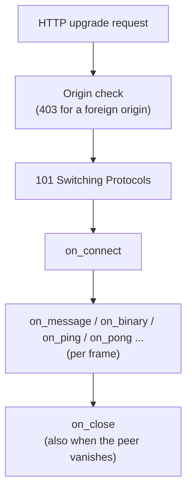

# Real-time

## Why real-time?

HTTP is request and response: the server only speaks when asked, so a client that wants fresh data has to
poll. Real-time applications need instant updates, server-initiated messages and cheap two-way traffic.
A WebSocket keeps one connection open and lets both sides send whenever they like.

Azu offers two levels:

| Level | Use it when |
| --- | --- |
| `Azu::Channel` | You want your own protocol: chat messages, notifications, a JSON feed for a JavaScript client. |
| `Azu::Spark::Component` | You want the server to render the UI and keep it in sync without writing JavaScript. See [Components](components.md). |

Both subscribe to topics of `Azu::PubSub`, so a broadcast reaches channels and components alike.

## WebSocket channels

A channel is one WebSocket connection. Azu creates a new instance per client, so instance variables
are per connection. All six callbacks are abstract: a channel that omits one does not compile.

```crystal
class ChatChannel < Azu::Channel
  ws "/chat"

  def on_connect
    subscribe "chat"
    send({type: "welcome"}.to_json)
  end

  def on_message(message : String)
    broadcast "chat", message
  end

  def on_binary(binary : Bytes)
  end

  def on_ping(message : String)
  end

  def on_pong(message : String)
  end

  def on_close(code : HTTP::WebSocket::CloseCode?, message : String?)
  end
end
```

`ws "/chat"` registers the route. `subscribe` joins a PubSub topic; each `broadcast` to it arrives in
`on_broadcast`, which writes the payload to the socket by default. Subscriptions end with the connection.

### Channel lifecycle



The server pings every `websocket.ping_interval` (30 seconds by default) so dead peers are noticed,
and a frame larger than `websocket.max_message_size` (1 MiB) closes the connection. Both are set on
`Azu::CONFIG.websocket`. Upgraded sockets also have `TCP_NODELAY` set (`websocket.tcp_nodelay`, on by default), so
the several small writes of one reply are not held back for the peer's delayed ACK.

## Topics with PubSub

`Azu::PubSub` is a process-wide topic bus. Channels use it through `subscribe`, `unsubscribe` and
`broadcast`; any other code can use it directly:

```crystal
Azu::PubSub.broadcast("orders", {id: 42, status: "paid"}) # JSON encoded

subscription = Azu::PubSub.subscribe("orders") do |message|
  puts message.topic
  puts message.payload
end

subscription.cancel
```


Handlers run on the broadcaster's fiber, so they must be quick: enqueue and return.


### Rooms

A room is just a topic name:

```crystal
class RoomChannel < Azu::Channel
  def on_connect
    subscribe "room:#{context.request.path_params["room"]}"
  end

  def on_message(message : String)
    broadcast "room:#{context.request.path_params["room"]}", message
  end

  def on_binary(binary : Bytes)
  end

  def on_ping(message : String)
  end

  def on_pong(message : String)
  end

  def on_close(code : HTTP::WebSocket::CloseCode?, message : String?)
  end
end

Azu::CONFIG.router.ws "/rooms/:room", RoomChannel
```

### Messages to one user

Give every user a topic and broadcast to it from anywhere in your application, for example from an
endpoint or a background job:

```crystal
class UserChannel < Azu::Channel
  def on_connect
    subscribe "user:#{params["user_id"]?}"
  end

  def on_message(message : String)
  end

  def on_binary(binary : Bytes)
  end

  def on_ping(message : String)
  end

  def on_pong(message : String)
  end

  def on_close(code : HTTP::WebSocket::CloseCode?, message : String?)
  end
end

def notify(user_id : Int64, text : String) : Nil
  Azu::PubSub.broadcast("user:#{user_id}", {type: "notification", text: text})
end
```


In a real application, take the user id from a verified session or token, never from a parameter the
client controls (see Authentication below).


### Presence

`Azu::Presence` answers "who is in this topic right now?", across processes. Include
`Azu::Presence::Tracked` in a channel and what it tracks is untracked when the socket ends, however it ends
(close frame, dropped peer, a handler that raised). Joins and leaves are published as diffs through PubSub,
and `presence_updates` forwards them to the socket:

```crystal
class RoomChannel < Azu::Channel
  include Azu::Presence::Tracked

  def on_connect
    user = params["user"]? || "anonymous"
    presence_updates("room:1") # joins and leaves reach this socket as JSON, its own join included
    track_presence("room:1", user, {device: params["device"]?})
    send({type: "online", users: Azu::Presence.list("room:1").keys}.to_json)
  end

  def on_message(message : String)
  end

  def on_binary(binary : Bytes)
  end

  def on_ping(message : String)
  end

  def on_pong(message : String)
  end

  def on_close(code : HTTP::WebSocket::CloseCode?, message : String?)
  end
end
```

As with the user id above, take `user` from a verified session or token in a real application (see
Authentication below). A user with several sockets is one key with several entries, and counts as
departed only when the last one closes. The default store keeps presence in one process; with several
servers, give every node `Azu::Presence::Store::Redis` and the Redis PubSub backend (see
[Real-time across processes](../../how-to/deployment/scale-horizontally.md#real-time-across-processes)). Every option is in the
[Presence reference](../../reference/api/presence.md).

## Message protocol

A channel moves strings (and bytes). Most applications send JSON with a `type` field and parse it into
a `JSON::Serializable` type so that bad input fails in one place:

```crystal
struct Incoming
  include JSON::Serializable

  getter type : String
  getter body : String?
end

class JsonChannel < Azu::Channel
  def on_connect
  end

  def on_message(message : String)
    incoming = Incoming.from_json(message)
    case incoming.type
    when "ping" then send({type: "pong"}.to_json)
    when "say"  then broadcast "chat", {type: "say", body: incoming.body}.to_json
    else             send({type: "error", code: "UNKNOWN_TYPE"}.to_json)
    end
  rescue JSON::ParseException | JSON::SerializableError
    send({type: "error", code: "INVALID_JSON"}.to_json)
  end

  def on_binary(binary : Bytes)
  end

  def on_ping(message : String)
  end

  def on_pong(message : String)
  end

  def on_close(code : HTTP::WebSocket::CloseCode?, message : String?)
  end
end
```

The browser side:

```javascript
const ws = new WebSocket("ws://localhost:4000/chat");

ws.onopen = () => ws.send(JSON.stringify({ type: "say", body: "hello" }));
ws.onmessage = (event) => handle(JSON.parse(event.data));
```


An exception that escapes a callback ends that connection, so rescue what you can recover from and
answer with an error message as above.


## Authentication

Browsers cannot set headers on a WebSocket, so authenticate with the query string (`?token=...`) or with
the cookies the browser sends with the upgrade request. Both are available from `on_connect`:

```crystal
class AccountChannel < Azu::Channel
  def on_connect
    unless user = authenticate(params["token"]?)
      close(HTTP::WebSocket::CloseCode::PolicyViolation, "Unauthorized")
      return
    end
    subscribe "user:#{user}"
    send({type: "authenticated", user: user}.to_json)
  end

  def on_message(message : String)
  end

  def on_binary(binary : Bytes)
  end

  def on_ping(message : String)
  end

  def on_pong(message : String)
  end

  def on_close(code : HTTP::WebSocket::CloseCode?, message : String?)
  end

  # Replace with your own verification (a signed token, a session lookup, ...).
  private def authenticate(token : String?) : String?
    expected = ENV["CHANNEL_TOKEN"]?.presence
    return unless expected && token # refuse every connection while CHANNEL_TOKEN is unset
    "alice" if Crypto::Subtle.constant_time_compare(token, expected)
  end
end
```

The upgrade is also protected against cross-site WebSocket hijacking: the `Origin` header must be the
application's own origin or listed in `Azu::CONFIG.websocket.allowed_origins`.

## Scaling

By default PubSub is in memory: a broadcast reaches the subscribers in the same process. With several
servers, select the Redis backend once at boot, and every `broadcast` reaches the subscribers of every
process:

```crystal
Azu::PubSub.backend = Azu::PubSub::Redis.new(ENV.fetch("REDIS_URL", "redis://localhost:6379/0"))
```

Channels and Spark components need no change. What stays per process is whatever you keep in your own
variables, and presence until it uses `Azu::Presence::Store::Redis`. WebSockets are sticky to the server
that accepted them. On shutdown every open channel socket is sent a close frame with code 1001 (going
away) and waited for within `shutdown_timeout`, and Spark connections are closed with a "service restart"
code, so the browser reconnects to another process (see [Shut Down Gracefully](../../how-to/deployment/graceful-shutdown.md)).

## See also

- [Components](components.md)
- [Channel Reference](../../reference/api/channel.md)
- [How to create a WebSocket channel](../../how-to/real-time/create-websocket-channel.md)
