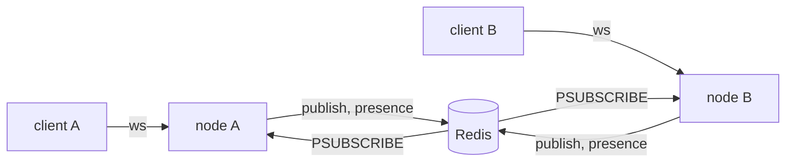

# Scale horizontally

## Stateless design

Each process has its own memory: a second instance does not see a hash, a counter or a default `Azu.cache` entry
that the first one filled. Keep anything that must be shared in the database, or in a shared cache (see
[Redis cache](../caching/setup-redis-cache.md)):

```crystal
# In-memory state lives in one process only
USERS_CACHE = {} of Int64 => String

# A shared store: with the Redis store, every instance reads the same entry
Azu.cache.set("user:1", %({"id":1}))
```

Things that are per process in Azu:

- the memory cache (`CACHE_STORE=memory`, the default);
- `Azu::Handler::Throttle` counters;
- the in-memory `Azu::PubSub` backend and the default `Azu::Presence` store (see
  [Real-time across processes](#real-time-across-processes));
- the CSRF key while `CSRF_SECRET` is unset: `Azu::Handler::CSRF` reads `CSRF_SECRET` itself (and raises in production
  without it), so set the same `CSRF_SECRET` everywhere;
- the Spark signing secret: set the same `SPARK_SECRET` everywhere.

## Session storage

A session is a random id in a cookie that points at data in a shared store. With a shared cache:

```crystal
require "json"

class SessionStore
  def self.create(user_id : Int64) : String
    session_id = Random::Secure.hex(32)
    Azu.cache.set("session:#{session_id}", {user_id: user_id}.to_json, 24.hours)
    session_id
  end

  def self.get(session_id : String) : Int64?
    data = Azu.cache.get("session:#{session_id}")
    return unless data
    JSON.parse(data)["user_id"].as_i64
  end
end
```

## Load balancer configuration

Any load balancer works. Point its health check at
[`Azu::Handler::HealthCheck`](../../reference/handlers/built-in.md#handlerhealthcheck), and pass the `Upgrade` and
`Connection` headers through so channels can open WebSockets. Behind a proxy every connection comes from the
proxy's address; [`Handler::Throttle`](../../reference/handlers/built-in.md#handlerthrottle) and
[`Handler::IpSpoofing`](../../reference/handlers/built-in.md#handleripspoofing) state what that means for rate limits
and forwarded headers.

## Graceful rollouts

On `SIGTERM` an instance stops accepting connections and waits for requests in flight, up to
`SHUTDOWN_TIMEOUT` seconds (30 by default), before it exits. Set the grace period of the orchestrator above it
(for example `terminationGracePeriodSeconds: 45` in Kubernetes, `docker stop -t 40`), and let the load balancer's
health check take the instance out of rotation. Open WebSockets are sent a close frame with code 1001 when the stop
begins, so clients reconnect to another instance; see [Shut Down Gracefully](graceful-shutdown.md).

## Real-time across processes

`Azu::PubSub` and `Azu::Presence` keep their state in one process by default. Every node runs the same code against
one Redis; the load balancer may send a client to any node, with no sticky routing and no leader:



Select the Redis PubSub backend and the Redis presence store at boot, before the first connection is served. Then
every node receives every broadcast and lists the users of every node:

```crystal
url = ENV.fetch("REDIS_URL", "redis://localhost:6379/0")
Azu::PubSub.backend = Azu::PubSub::Redis.new(url)
Azu::Presence.default = Azu::Presence::Tracker.new(
  Azu::Presence::Store::Redis.new(url),
  node: "#{System.hostname}-#{Random::Secure.hex(4)}",
  ttl: 30.seconds)

class NotificationChannel < Azu::Channel
  ws "/notifications"

  def on_connect
    subscribe "notifications"
  end

  def on_message(message : String)
  end

  def on_binary(binary : Bytes)
  end

  def on_ping(message : String)
  end

  def on_pong(message : String)
  end

  def on_close(code : HTTP::WebSocket::CloseCode?, message : String?)
  end
end

# From any instance
Azu::PubSub.broadcast("notifications", {text: "Deploy finished"})
```

- **Node id.** `node` is the prefix of every presence `ref`, so each process needs its own, and a new one after a
  restart: a restarted process must not reuse the counter of its previous life while its old entries may still be
  expiring. The default, a random id per boot, does that; a hostname alone does not.
- **Prefixes.** Environments that share one Redis need their own prefixes, the second argument of both constructors:
  `Azu::PubSub::Redis.new(url, "staging:pubsub:")` and `Azu::Presence::Store::Redis.new(url, "staging:presence:")`.
- **Connections.** Each process holds one dedicated subscriber connection, opened at the first subscribe, plus a
  pool of at most 2 connections that the publisher and the presence store share when built from the same URL (see
  [Redis](../../reference/api/redis.md)). Subscriber handlers run on the listener's fiber, so keep them short.


Broadcasts published while a node's subscriber reconnects are lost;
[Presence](../../reference/api/presence.md#guarantees) lists what holds after a dropped connection, a Redis outage or
a crashed node. See also [Broadcast messages](../real-time/broadcast-messages.md).


## Database scaling

### Read replicas

Define one schema per database and point read-only work at the replica:

```crystal
require "cql"
require "pg"

PrimaryDB = CQL::Schema.define(:primary, adapter: CQL::Adapter::Postgres, uri: ENV["DATABASE_URL"]) do
  table :users do
    primary :id, Int64
    column :name, String
  end
end

ReplicaDB = CQL::Schema.define(:replica, adapter: CQL::Adapter::Postgres, uri: ENV["DATABASE_REPLICA_URL"]) do
  table :users do
    primary :id, Int64
    column :name, String
  end
end

class User
  include CQL::ActiveRecord::Model(Int64)
  db_context PrimaryDB, :users

  property name : String

  def initialize(@name : String)
  end
end

class ReadOnlyUser
  include CQL::ActiveRecord::Model(Int64)
  db_context ReplicaDB, :users

  property name : String

  def initialize(@name : String)
  end
end
```


A replica lags behind the primary, so read your own writes from the primary.


### Connection pooling

Each process opens its own database pool (the pool options go in the database URL, see
[Adapters](../../reference/database/cql-api.md#adapters)), so the connections add up across processes.

## Cache scaling

The memory cache is per process. Select the Redis store through the environment (see
[Redis cache](../caching/setup-redis-cache.md)):

```bash
CACHE_STORE=redis
CACHE_REDIS_URL=redis://redis.example.com:6379/0
```

## Monitoring at scale

`RequestId` (part of the default stack) tags every request with an id that the `Logger` line and error pages carry.
Log the instance once at boot so a line can be traced to its host:

```crystal
module MyApp
  include Azu
end

MyApp.log.info { "instance #{ENV.fetch("HOSTNAME", "unknown")} version #{ENV.fetch("APP_VERSION", "unknown")}" }
```

## See also

- [Configure Production](configure-production.md)
- [Deploy with Docker](deploy-with-docker.md)
- [Presence](../../reference/api/presence.md)
