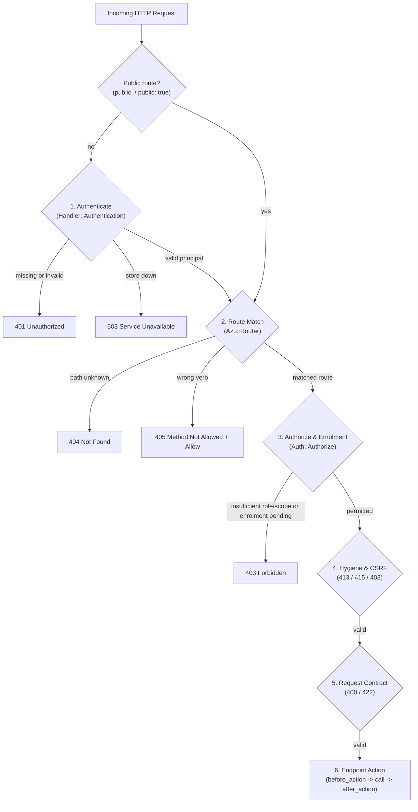

# Authentication and authorization

`Azu::Auth`, `Azu::Access`, and `Azu::Handler::Authentication` authenticate callers before routing and authorize them against per-route role, permission, and OAuth 2.0 scope rules after routing. They are part of `require "azu"`. Authentication runs before the segment tree matches a path, so an unauthenticated request gets `401` without revealing which paths or methods exist; authorization runs as a post-match router hook after `404` and `405` and before the endpoint action.

<!-- prelude -->
```crystal
require "azu"

struct SecretEndpoint
  include Azu::Endpoint(Azu::Request, Azu::Response::Empty)

  get "/secrets"
  require_role :operator
  require_scopes "secrets:read"

  def call : Azu::Response::Empty
    Azu::Response::Empty.new
  end
end
```

```crystal
app = Azu::App.new
app.config.api_defaults!
app.config.auth.jwt Azu::Env.secret("JWT_SECRET"),
  issuer: "https://auth.example.com",
  audience: "https://api.example.com"
app.config.auth.role_hierarchy :viewer, :operator, :admin

app.routes do
  endpoint SecretEndpoint
end
```

## API

### Principals (`Azu::Auth::Principal` and `Azu::Auth::Identity`)

`Azu::Auth::Principal` is an abstract reference class stored on `HTTP::Server::Context#principal`. `Azu::Auth::Identity` is the built-in concrete subclass.

| Method | Returns | Notes |
|---|---|---|
| `Principal#id` | `String` | Subject identifier (`sub` claim in JWT / Authly tokens) |
| `Principal#name` | `String?` | Optional display name (`name` or `preferred_username` claim) |
| `Principal#roles` | `Enumerable(String)` | Granted role names |
| `Principal#permissions`, `Principal#scopes` | `Enumerable(String)` | Granted permissions / OAuth 2.0 scopes |
| `Principal#claims` | `Hash(String, JSON::Any)` | Verified token claims (`{}` when none) |
| `Principal#auth_scheme` | `Symbol` | `:bearer`, `:jwt`, `:cookie`, etc. Used by `Handler::CSRF` to exempt non-cookie credentials |
| `Principal#enrolment_pending?` | `Bool` | When `true`, refuses routes that are not `enrolment_exempt: true` or `public: true` with `403` |
| `Principal#valid?(context)` | `Bool` | Per-request validity hook; returning `false` answers `401` |
| `Principal#has_role?(role)` | `Bool` | Exact role membership check |
| `Principal#has_permission?(perm)`, `Principal#has_scope?(scope)` | `Bool` | Exact permission / scope membership check |
| `Principal#mfa_verified?` | `Bool` | `true` when multi-factor authentication has been verified (`mfa` claim, `amr` containing `"challenge_response"`/`"mfa"`/`"totp"`/`"webauthn"`, or `acr` `"aal2"`/`"aal3"`/`"mfa"`/`"phr"`) |
| `Principal#amr` | `Enumerable(String)` | Authentication Method References (`amr` claim) |
| `Principal#acr` | `String?` | Authentication Context Class Reference (`acr` claim) |
| `Principal#has_amr?(method)` | `Bool` | Case-insensitive `amr` membership check |
| `Principal#challenge_authenticated?` | `Bool` | `true` when `amr` includes `"challenge_response"` or `"urn:ietf:params:oauth:grant-type:challenge"` |
| `Principal#social_authenticated?` | `Bool` | `true` when `auth_provider` is present or `amr` includes `"social"` / `"urn:ietf:params:oauth:grant-type:social"` |
| `Principal#auth_provider`, `Identity#provider` | `String?` | Social / identity provider name (`"google"`, `"github"`, etc., from `provider`/`idp` claim or `"social:<provider>"` `cid`) |
| `Principal#social_uid` | `String?` | External provider subject identifier (`social_uid` / `idp_sub` claim) |
| `Identity.from_claims(payload)` | `Identity` | Builds an `Identity` from a `Hash(String, JSON::Any)` or `Authly::Claims` |
| `Identity#client_id` | `String?` | `"cid"` or `"client_id"` claim |
| `Identity#token_id` | `String?` | `"jti"` claim |
| `Identity#email` / `Identity#email_verified?` | `String?` / `Bool` | `"email"` and `"email_verified"` claims (OIDC / social sign-in) |
| `Identity#key_id` | `String?` | `"kid"` or `"key_id"` claim (cryptographic challenge-response key ID) |

On `HTTP::Server::Context`:
- `context.principal` / `context.principal?` / `context.current_user` / `context.current_user?` returns `Azu::Auth::Principal?` (automatically bridging `context.authly_claims` when `Authly::Handler::Bearer` is used).
- `context.principal!` / `context.current_user!` returns `Azu::Auth::Principal` or raises `Azu::Response::AuthenticationError` (`401`).

### Authenticators (`Azu::Auth::Authenticator`)

| Type | Purpose |
|---|---|
| `Azu::Auth::JWTAuthenticator` | Verifies `HS256`, `HS384`, and `HS512` JWTs (`alg`, HMAC signature in constant time, `exp`, `nbf`, `iss`, `aud`, `leeway`, and an optional revocation `&validator` block) using Crystal's standard library |
| `Azu::Auth::BearerAuthenticator` | Verifies `Authorization: Bearer <token>` against SHA-256 hashed static tokens (compared in constant time) and/or a lookup block `(String, HTTP::Server::Context) -> Principal?` |
| `Azu::Auth::AuthlyAuthenticator(V)` | Wraps an [Authly](https://github.com/azutoolkit/authly) `Authly::TokenVerifier` (`Authly::StrategyTokenVerifier`) or any object responding to `#verify(token : String)`, populates `context.principal` and `context.authly_claims`, and translates `VerificationUnavailable` into `503 Service Unavailable` with `Retry-After: 1` |
| `Azu::Auth::ProcAuthenticator` | Wraps a `(HTTP::Server::Context) -> Principal?` proc |
| `Azu::Auth::ChainAuthenticator` | Tries multiple `Authenticator` instances in sequence until one returns a `Principal` |

### Access requirements (`Azu::Access` and `Azu::RouteOptions`)

| Signature | Returns | Meaning |
|---|---|---|
| `Azu::Access.role(*roles)` | `Access::Requirement` | Requires any of the listed roles (or a higher role in `config.auth.roles`) |
| `Azu::Access.permissions(* perms)`, `Azu::Access.scopes(*scopes)` | `Access::Requirement` | Requires all listed permissions / OAuth 2.0 scopes |
| `Azu::Access.any_permission(*perms)`, `Azu::Access.any_scope(*scopes)` | `Access::Requirement` | Requires at least one of the listed permissions / scopes |
| `Azu::Access.mfa(*amr, acr = nil)` | `Access::Requirement` | Requires multi-factor authentication (`principal.mfa_verified?`), optionally constraining `amr` and/or `acr` |
| `Azu::Access.challenge_response` | `Access::Requirement` | Requires Authly challenge-response MFA (`mfa: true` and `amr` matching `"challenge_response"` or `"urn:ietf:params:oauth:grant-type:challenge"`) |
| `Azu::Access.social(*providers)` | `Access::Requirement` | Requires social login authentication (`principal.social_authenticated?`), optionally constrained to one of `providers` (e.g. `:google`, `:github`) |
| `Azu::Access.authenticated` | `Access::Requirement` | Requires an authenticated principal without a specific role or scope constraint |
| `req_a & req_b` | `Access::Requirement` | Combines two requirements so both must hold |
| `req.satisfied_by?(principal, role_hierarchy)` | `Bool` | Evaluates role, permission, scope, social, and MFA constraints against `principal` |

`Azu::RouteOptions` holds per-route security, hygiene, audit, and OpenAPI metadata (`requires`, `public`, `enrolment_exempt`, `csrf_exempt`, `audit`, `audit_action`, `audit_critical`, `summary`, `description`, `max_body_size`, `content_types`, plus shorthand keywords `role:`, `roles:`, `permissions:`, `scopes:`, `mfa:`, `amr:`, `acr:`, `challenge_response:`, `social:`) and composes in three layers:
`scope_options.merge(endpoint.route_options).merge(call_site_options)`.

### Handlers and router hooks

| Type | Stage | Purpose |
|---|---|---|
| `Azu::Handler::Authentication` | Pre-routing `HTTP::Handler` | Skips routes where `router.public_route?(context)` is true; otherwise runs the authenticator and `principal.valid?(context)`, answering `401` on missing/invalid credentials or `503` on `Auth::VerificationUnavailable` |
| `Azu::Auth::Authorize` | Post-match `Router::Hook` (`before_dispatch`) | Checks `route.effective_requirement(config.auth)` and the enrolment gate (`principal.enrolment_pending?` or `config.auth.enrolment_gate`), answering `403` when denied |
| `Azu::Auth::AuditHook` | Post-match `Router::Hook` (`around_dispatch` + `after_dispatch`) | Emits `Instrumentation::AuditEvent` records; for `audit_critical: true` routes, writes a `Pending` record before the action and answers `503` (`code: "audit_unavailable"`) if the audit write fails |

## Options

`config.auth` is an `Azu::Auth::Configuration`:

| Option / Builder | Type | Default | Meaning |
|---|---|---|---|
| `enabled?` / `enabled=` | `Bool` | `false` | Installs `Handler::Authentication`, `Auth::Authorize`, `Hygiene::BodyCheck`, and `Auth::AuditHook` in `App#default_handlers`. Automatically becomes `true` when `jwt`, `bearer`, `authenticate`, or `authly` is called |
| `jwt(secret, *, issuer, audience, algorithm, leeway, &validator)` | `JWTAuthenticator` | — | Configures HMAC JWT verification, sets `bearer_format ||= "JWT"`, and enables `config.auth` |
| `bearer(tokens, &lookup)` | `BearerAuthenticator` | — | Configures Bearer token authentication and enables `config.auth` |
| `authenticate(&block)` | `ProcAuthenticator` | — | Configures a custom authentication block and enables `config.auth` |
| `authly(verifier, *, realm = "authly", provider = false, &validator)` | `AuthlyAuthenticator` | — | Configures Authly / `TokenVerifier` authentication, enables `config.auth`, and when `provider: true` mounts Authly's OAuth 2.0 / OIDC provider routes |
| `role_hierarchy(*roles)` | `Array(String)` | `[]` | Sets `roles` from lowest to highest privilege and defaults `GET`/`HEAD` to `roles.first` and `POST`/`PUT`/`PATCH`/`DELETE` to `roles[1]? \|\| roles.first` |
| `roles` / `roles=` | `Array(String)` | `[]` | Ordered role names from lowest to highest privilege without changing verb defaults |
| `default_read_role=` / `default_write_role=` | `Symbol \| String` | — | Sets the default role for `GET`/`HEAD` or `POST`/`PUT`/`PATCH`/`DELETE` |
| `default_access(verb, requirement)` | `Access::Requirement` | — | Sets the default requirement for a single HTTP verb |
| `default_access` | `Access::Requirement?` | `nil` | Fallback requirement when a verb has no entry in `verb_defaults` |
| `enrolment_gate` | `Proc(Principal, Router::Route, Bool)?` | `nil` | Custom enrolment check returning `true` when allowed or `false` when blocked (`403`) |
| `enrolment_error_code` / `enrolment_error_message` | `String` | `"enrolment_required"` | Error code and message returned on `403` when an account fails the enrolment gate |
| `mfa_gate` | `Proc(Principal, Router::Route, Bool)?` | `nil` | Custom step-up MFA check returning `true` when allowed or `false` when blocked (`403` with `mfa_error_code`) |
| `mfa_error_code` / `mfa_error_message` | `String` | `"mfa_required"` | Error code and message returned on `403` when a route requires MFA and the token has not satisfied it |
| `mfa_www_authenticate` | `String` | `"Bearer error=\"insufficient_user_authentication\", ..."` | `WWW-Authenticate` challenge header set on `403 mfa_required` responses |
| `unauthorized_code` / `unauthorized_message` / `www_authenticate` | `String` | `"unauthorized"` / `"Authentication required"` / `"Bearer"` | Default `401` code, message, and `WWW-Authenticate` header |
| `forbidden_code` / `forbidden_message` | `String` | `"forbidden"` / `"Insufficient permissions"` | Default `403` code and message |
| `security_scheme_name` / `bearer_format` | `String` / `String?` | `"bearerAuth"` / `nil` | OpenAPI security scheme name and optional `bearerFormat` |

## Behavior

### Request check order

When `config.auth` is enabled, Azu enforces a fixed check order across the request lifecycle:



### Boot validation (`Configuration#check_auth_boot!`)

Before binding a socket (`App#start`, `App#validate_pipeline!`, `Configuration#check_boot`), Azu checks that the security configuration is complete and raises `Azu::Configuration::BootError` when:
1. Any route declares `requires:` (or `config.auth` is enabled), but `Azu::Auth::Authorize` is not registered on the router.
2. `Azu::Auth::Authorize` is active, but no `Azu::Handler::Authentication`, `Azu::Auth::AuthenticationStage`, or `Authly::Handler::Bearer` is in the handler pipeline.
3. `Azu::Auth::Authorize` is active, and a route is neither `public: true` nor covered by an explicit `requires:` or verb default.
4. Any route or default references a role name not listed in `config.auth.roles` (when `config.auth.roles` is non-empty).

## Limits

- `Azu::Auth::JWTAuthenticator` verifies HMAC (`HS256`, `HS384`, `HS512`) tokens using Crystal's standard library. For asymmetric algorithms (`RS256`, `ES256`, `EdDSA`), JWKS key rotation, opaque tokens, and OAuth 2.0 / OIDC grants, use `config.auth.authly` with [Authly](https://github.com/azutoolkit/authly).
- Signed JWTs remain valid until their `exp` timestamp unless you supply a revocation block to `config.auth.jwt` / `config.auth.authly` or use Authly's revocation store.

## See also

- [Authenticate and authorize requests](../../how-to/middleware/authenticate-and-authorize.md)
- [Protect forms and APIs](../../how-to/middleware/protect-forms-and-apis.md)
- [Endpoint](endpoint.md)
- [Router](router.md)
- [Error types](../errors/error-types.md)
