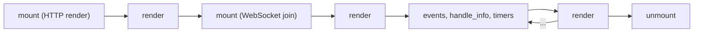

# Building live components

The state lives on the server; the browser only sends events and applies the HTML the
server sends back.

## What you'll build

By the end of this tutorial, you'll have:

- A reactive counter component
- A live chat room shared by every open browser tab
- A form with server-side validation
- Components that contain other components
- Tests for all of them, without a browser

## Prerequisites

- Completed [Adding WebSockets](adding-websockets.md) tutorial
- Understanding of WebSocket basics
- Crystal 1.22.1 or newer

## Step 1: Understanding live components

A live component (`Azu::Spark::Component`) gives you:

- **Server-side state** - `state` values are typed instance variables owned by the server
- **Event-driven interactions** - `event def` methods are the only code the browser can trigger
- **Real-time DOM updates** - assigning state re-renders the component and sends only its new HTML
- **Automatic synchronization** - one WebSocket per page connects every component on it

You never write the WebSocket handling or the DOM patching: the framework serves a small client script
(`Azu::Spark.script_tag`) that does it.

## Step 2: Create a counter component

Create `src/components/counter.cr`:


```crystal
class Counter < Azu::Spark::Component
  mountable

  prop label : String = "Clicks"
  state count : Int32 = 0

  event def increment(by : Int32 = 1) : Nil
    self.count += by
  end

  event def reset : Nil
    self.count = 0
  end

  def render
    div class: "counter" do
      h2 "#{label}: #{count}"
      button "+1", **spark_click(:increment)
      button "+10", **spark_click(:increment, by: 10)
      button "Reset", **spark_click(:reset)
    end
  end
end
```


- `mountable` allows the component to be rendered from a page.
- `prop` is an input from the page, read only. `state` is owned by the server; assigning it
  (`self.count += by`) schedules a render.
- `event def` declares what the browser may call. `by` is read from the event payload and converted to
  an `Int32`; a payload that does not fit is rejected before the method runs.
- `spark_click(:increment, by: 10)` produces the `spark-*` attributes that make the button send the
  event. Double-splat it (`**`) into the tag, before any named arguments.
- `render` describes the HTML with the same DSL as `Azu::Component`. Note that `p` is not a tag helper;
  write `tag(:p) { text "..." }` when you need a paragraph.

## Step 3: Show it on a page

Create `src/endpoints/counter_page.cr`. The endpoint renders the component with `Azu::Spark.render` and
adds the script tag:


```crystal
class Counter < Azu::Spark::Component
  mountable

  prop label : String = "Clicks"
  state count : Int32 = 0

  event def increment(by : Int32 = 1) : Nil
    self.count += by
  end

  def render
    div class: "counter" do
      h2 "#{label}: #{count}"
      button "+1", **spark_click(:increment)
    end
  end
end

struct CounterPageResponse
  include Azu::Response

  def render
    <<-HTML
    <!doctype html>
    <html>
      <head><title>Counter</title></head>
      <body>
        #{Azu::Spark.render(Counter, label: "Visits")}
        #{Azu::Spark.script_tag}
      </body>
    </html>
    HTML
  end
end

struct CounterPageEndpoint
  include Azu::Endpoint(Azu::Request, CounterPageResponse)

  get "/counter"

  def call : CounterPageResponse
    content_type "text/html"
    CounterPageResponse.new
  end
end
```


Then, once while booting (in `src/user_api.cr` or your main file), install Spark:


```crystal
require "azu"

module UserAPI
  include Azu
end

Azu::Spark.install

UserAPI.start
```


`Azu::Spark.install` registers the WebSocket route (`/spark`) and serves the client script from your own
application (`/_spark/azu_spark.js`), so there is no CDN and no inline script. The tokens that let a browser
join a component are signed with `SPARK_SECRET`, which Spark reads itself. Without it, development and test use
a random secret per process; in production and staging `Azu::Spark.install` raises `Azu::Spark::ConfigurationError`
at boot. Set `SPARK_SECRET` there.

Run the app (Azu listens on `PORT`, 4000 by default), open `http://localhost:4000/counter` and click the buttons. Open the page in two tabs: each
tab has its own counter, because each connection owns its components.

## Step 4: Create a chat component

A chat room has to reach every open tab, so it uses a PubSub topic. Create `src/components/chat_room.cr`:


```crystal
class ChatRoom < Azu::Spark::Component
  mountable

  TOPIC = "chat"

  state name : String = "guest"
  state lines : Array(String) = [] of String

  def mount(socket : Azu::Spark::Socket, params : Azu::Spark::Params) : Nil
    self.name = "guest-#{socket.id[-4..]}"
    socket.subscribe(TOPIC)
  end

  def handle_info(message : Azu::PubSub::Message, socket : Azu::Spark::Socket) : Nil
    self.lines = (lines + [message.payload]).last(20)
  end

  event def say(text : String) : Nil
    text = text.strip
    return if text.empty?
    socket.broadcast(TOPIC, "#{name}: #{text[0, 200]}")
  end

  def render
    div class: "chat" do
      h2 "Chat (you are #{name})"
      ul do
        lines.each { |line| li line }
      end
      form(**spark_submit(:say, disable_with: "Sending...")) do
        input type: "text", name: "text", autocomplete: "off"
        button "Send", type: "submit"
      end
    end
  end
end
```


- `mount` subscribes the component to the topic. Subscriptions end by themselves when the component
  goes away.
- `socket.broadcast` publishes to every subscriber, in every tab. Each one receives the payload in
  `handle_info`, assigns `lines`, and is re-rendered.
- The form's `text` field is sent as the `text` parameter of `say`.

Serve it with an endpoint like Step 3's (`Azu::Spark.render(ChatRoom)`), open the page in two tabs and
talk to yourself.

The counter and the chat room run together in one app, next to two more components, in
[`playground/spark_demo/app.cr`](https://github.com/azutoolkit/azu/blob/master/playground/spark_demo/app.cr): start it
with `crystal run playground/spark_demo/app.cr` from a clone of the repository.

## Step 5: Component lifecycle

```crystal
class Clock < Azu::Spark::Component
  mountable

  state now : String = Time.utc.to_s("%H:%M:%S")

  def mount(socket : Azu::Spark::Socket, params : Azu::Spark::Params) : Nil
    socket.every(1.second, "tick")
  end

  def handle_info(message : Azu::PubSub::Message, socket : Azu::Spark::Socket) : Nil
    self.now = Time.utc.to_s("%H:%M:%S")
  end

  def unmount(socket : Azu::Spark::Socket) : Nil
    # Timers and subscriptions are cancelled for you; release anything else here.
  end

  def render
    span now
  end
end
```



`mount` runs on the initial HTTP render, where `socket.connected?` is `false` and timers and
subscriptions are not started yet, and again when the browser joins. `handle_info` receives PubSub
broadcasts, timers (`every`, `send_after`) and messages from `send_info`.

## Step 6: State management

```crystal
class Settings < Azu::Spark::Component
  mountable

  state theme : String = "light"
  state compact : Bool = false
  state visits : Int32 = 0, persist: true

  event def configure(theme : String, compact : Bool = false) : Nil
    assign theme: theme, compact: compact
  end

  event def visit : Nil
    self.visits += 1
  end

  def render
    div class: "settings #{theme} #{compact ? "compact" : ""}" do
      span "visits: #{visits}"
      button "Dark", **spark_click(:configure, theme: "dark", compact: true)
      button "Visit", **spark_click(:visit)
    end
  end
end
```

- Assigning a value equal to the current one does nothing, so no render is scheduled.
- `assign theme: ..., compact: ...` assigns several states at once; names and types are checked at
  compile time.
- `persist: true` keeps the value in a signed snapshot held by the browser, so `visits` survives a
  reconnect and a server restart. Persist only small, non-secret, JSON-serializable values.

## Step 7: Form components

A form event can take an `Azu::Request` as its parameter. The payload is turned into the request exactly
like a submitted form, so the contract you already use for endpoints validates it.

```crystal
struct SignupRequest
  include Azu::Request

  getter name : String
  getter email : String

  def initialize(@name : String = "", @email : String = "")
  end

  validate name, presence: true, message: "Name is required"
  validate email, presence: true, match: /@/, message: "Email must be valid"
end

class SignupForm < Azu::Spark::Component
  mountable

  state signup : SignupRequest = SignupRequest.new
  state submitted : Bool = false

  event def submit(signup : SignupRequest) : Nil
    self.signup = signup
    self.submitted = true
  end

  private def problems(field : Symbol) : Array(String)
    submitted ? errors_on(signup, field) : [] of String
  end

  def render
    return div("Welcome, #{signup.name}!") if submitted && signup.valid?

    form(**spark_submit(:submit, disable_with: "Saving...")) do
      input type: "text", name: "name", value: signup.name, placeholder: "Name"
      problems(:name).each { |message| span message, class: "error" }
      input type: "email", name: "email", value: signup.email, placeholder: "Email"
      problems(:email).each { |message| span message, class: "error" }
      button "Sign up", type: "submit"
    end
  end
end
```

`errors_on(request, field)` returns the messages of the failed validations for a field. Use
`spark_change(:event, debounce: 300)` on an input for validation as the user types.

## Step 8: Composing components

Split the page into components that update independently. `live` embeds a child; `key` identifies it among
its siblings, and `container` chooses the element that wraps it.

```crystal
class TodoItem < Azu::Spark::Component
  container "li", class: "todo"

  prop text : String
  state done : Bool = false

  event def toggle : Nil
    self.done = !done
  end

  def render
    button "#{done ? "[x]" : "[ ]"} #{text}", **spark_click(:toggle)
  end
end

class TodoList < Azu::Spark::Component
  mountable

  state items : Hash(String, String) = {"docs" => "Write docs", "ship" => "Ship"}

  def render
    ul do
      items.each { |id, text| live TodoItem, key: id, text: text }
    end
  end
end
```

Toggling one item re-renders that item only, not the list and not its siblings. Use a stable key (an id,
not a list index that can shift).

## Step 9: Test your components

`Azu::Spark::Testing` mounts a component with a real session and no WebSocket, so mounting, events,
`handle_info` and children behave as in production:

```crystal
require "spec"

class Counter < Azu::Spark::Component
  prop label : String = "Clicks"
  state count : Int32 = 0

  event def increment(by : Int32 = 1) : Nil
    self.count += by
  end

  def render
    h2 "#{label}: #{count}"
  end
end

describe Counter do
  it "counts clicks" do
    Azu::Spark::Testing.mount(Counter, label: "Hits") do |view|
      view.trigger("increment")
      view.trigger("increment", by: 5)

      view.html.should contain("Hits: 6")
      view.assigns[:count].should eq 6
    end
  end
end
```

`view.broadcast(topic, payload)` delivers a PubSub message to the mounted component and `view.send_info`
sends it a message; both return after the component has handled them.

## Best practices

1. Keep state small; derive what you can in `render`.
2. Treat every `event def` like an endpoint: validate its input and check that the user may do it.
3. Put identity in `session:` claims or `socket.session`, never in a prop the page could be tricked
   into changing.
4. Use stable keys for child components.
5. Serve the socket over `wss` in production.

## Next steps


[spark-live-views.md](../explanation/spark-live-views.md)



[component.md](../reference/api/component.md)



[testing-your-app.md](testing-your-app.md)

