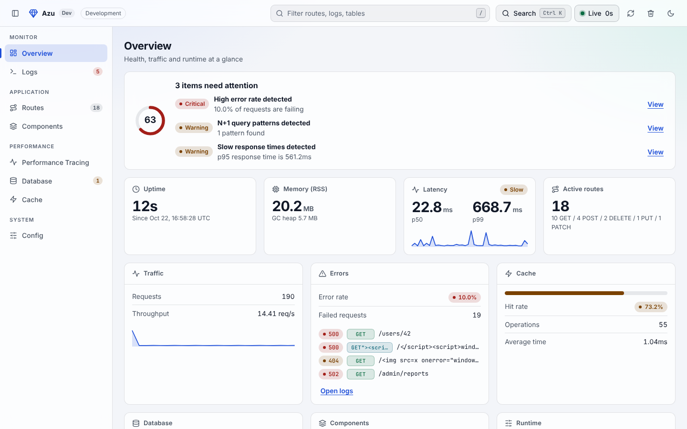

# Getting started

You type every file. You need [Crystal](https://crystal-lang.org/install/) 1.22.1 or newer and a terminal.

```bash
crystal --version
# Crystal 1.22.1 (...)
```


Prefer a generator? `azu new` writes a whole project for you; see [Get started in 5 minutes](https://github.com/azutoolkit/azu#get-started-in-5-minutes). This tutorial builds the pieces by hand so you see how they fit.


## 1. Create the project

```bash
mkdir hello && cd hello
mkdir src spec templates
```

Create `shard.yml`:


```yaml
name: hello
version: 0.1.0
crystal: ">= 1.22.1"

dependencies:
  azu:
    github: azutoolkit/azu
    version: ~> 0.10.0

targets:
  hello:
    main: src/server.cr
```


```bash
shards install
```

## 2. An endpoint with a contract

An Azu endpoint is `Endpoint(Request, Response)`: the request contract it accepts and the response it returns. Create `src/hello.cr`:


```crystal
require "azu"

module Hello
  include Azu

  configure do |config|
    config.templates.path = "./templates"
  end
end

struct GreetRequest
  include Azu::Request

  getter name : String

  validate name, size: 2..30, message: "must be 2 to 30 characters"

  def initialize(@name = "")
  end
end

struct GreetResponse
  include Azu::Response

  def initialize(@name : String)
  end

  def render
    {message: "Hello, #{@name}!"}.to_json
  end
end

struct GreetEndpoint
  include Azu::Endpoint(GreetRequest, GreetResponse)

  get "/hello"

  def call : GreetResponse
    content_type "application/json"
    GreetResponse.new greet_request.name
  end
end
```


`include Azu` makes `Hello` your app. Endpoints register themselves when they are defined, and `config.templates.path` (used in step 4) is where Azu looks for templates, relative to the directory you start the server in.

`greet_request` is the contract, already built from the query string (or the JSON or form body) and already validated. If validation fails, `call` never runs.

Create `src/server.cr`, the file that starts the app:

<!-- skip -->

```crystal
require "./hello"

Hello.start
```


Run it:

```bash
crystal run src/server.cr
```

```text
2026-10-26T00:35:20.332741Z   INFO - Azu: CRYSTAL_ENV not set, running in development, listening on 127.0.0.1
2026-10-26T00:35:20.332794Z   INFO - Azu: Server started at Mon 10/26/2026 12:35:20.
   ⤑  Environment: Development
   ⤑  Host: 127.0.0.1
   ⤑  Port: 4000
   ⤑  Startup Time: 0.272135 millis
```

In a second terminal:

```bash
curl "http://127.0.0.1:4000/hello?name=Ada"
# {"message":"Hello, Ada!"}

curl -H "Accept: application/problem+json" "http://127.0.0.1:4000/hello?name=A"
# {"type":"about:blank","title":"Validation Error","status":422,"detail":"The request could not be processed due to validation errors.","errors":{"name":["must be 2 to 30 characters"]},"instance":"/hello"}
```

The name `A` is too short, so Azu answered `422` with the failing field, and your `call` method did not run. The body is an [RFC 7807](https://www.rfc-editor.org/rfc/rfc7807) problem document. Its content type is `application/problem+json` only because the client asked for it in `Accept`; otherwise it is `application/json`, HTML or text, whichever the client accepts.

A request that leaves the field out entirely is a `400`, because the contract cannot even be built:

```bash
curl -H "Accept: application/json" "http://127.0.0.1:4000/hello"
# {"type":"about:blank","title":"Bad Request","status":400,"detail":"Missing required property: 'name'.","errors":[],"error_id":"dd7debd7409df9e9a279f3f67b62ec48","instance":"/hello","backtrace":"..."}
```

(`backtrace` appears in development only.) So: `400` means "I could not read that", `422` means "I read it, and the values are not acceptable".


Always pass an `Accept` header with curl in development; without one the error comes back as a plain-text debug page.



Azu listens on `127.0.0.1` in development. In a container set `HOST=0.0.0.0`.


## 3. A test

Tests use `Azu::Testing::Client`, which sends requests through the real handler chain and router without opening a socket. Create `spec/hello_spec.cr`:

<!-- skip -->

```crystal
require "spec"
require "azu/testing"
require "../src/hello"

describe "Hello" do
  client = Azu::Testing::Client.new

  it "greets by name" do
    response = client.get "/hello", params: {name: "Ada"}

    response.status_code.should eq 200
    response.json["message"].as_s.should eq "Hello, Ada!"
  end

  it "rejects a name that is too short" do
    response = client.get "/hello", params: {name: "A"}, headers: {"Accept" => "application/json"}

    response.status_code.should eq 422
    response.json["errors"]["name"].as_a.first.as_s.should eq "must be 2 to 30 characters"
  end
end
```


```bash
crystal spec
# 2 examples, 0 failures, 0 errors, 0 pending
```

The second test asks for JSON because that is what the test reads; without an `Accept` header the error comes back as text.

## 4. A page

Add a response that renders a Jinja template, and an endpoint for it. Append this to `src/hello.cr`:


```crystal
struct HomePage
  include Azu::Response
  include Azu::Templates::Renderable

  def render
    view "home.jinja", {"title" => "Hello, Azu", "names" => ["Ada", "Grace", "Linus"]}
  end
end

struct HomeEndpoint
  include Azu::Endpoint(Azu::Request, HomePage)

  get "/"

  def call : HomePage
    content_type "text/html"
    HomePage.new
  end
end
```


Create `templates/home.jinja`:


```jinja
<!doctype html>
<title>{{ title }}</title>
<h1>{{ title }}</h1>
<ul>

  <li>{{ link_to_get_greet("Greet " ~ name, params={"name": name}) }}</li>

</ul>
```


`link_to_get_greet` was generated for you: every endpoint gets link and form helpers named after its verb and type (`GreetEndpoint` with `get` gives `link_to_get_greet`), and they use the endpoint's real path. Rename the route and the links follow. See [Template helpers](../reference/templates/helpers.md#type-safe-endpoint-helpers).

Restart the server and open <http://127.0.0.1:4000/>. Add a third test while you are here:

<!-- skip -->
```crystal
  it "renders the home page with links to the endpoint" do
    response = client.get "/"

    response.status_code.should eq 200
    response.body.should contain %(<a href="/hello?name=Ada">Greet Ada</a>)
  end
```

Outside development Azu preloads templates (reads and parses them once) at boot, so a broken template fails at startup instead of on the first visitor. In development it reloads them when they change.

## 5. The development dashboard

The dashboard shows your routes, configuration, logs and request timings. It is opt-in and serves in development only. The timings come from the performance monitor, a second handler that records every request it sees. Change `src/server.cr`:

<!-- skip -->

```crystal
require "azu/dev"
require "./hello"

handlers = Azu::App.default.default_handlers
if monitor = Hello.config.performance_monitor # nil unless PERFORMANCE_MONITORING=true
  handlers.unshift monitor
end
handlers.unshift Azu::Handler::DevDashboard.new if Hello.env.development?

Hello.start handlers
```


`default_handlers` is the stack `Hello.start` uses on its own: request id, request logging, error pages, security headers and static files from `public/`. Passing your own array replaces it, which is why this step starts from the default list. The monitor and the dashboard go in front of it; the dashboard reads the numbers of that same monitor.

The monitor exists only while monitoring is on, so restart with the variable set:

```bash
PERFORMANCE_MONITORING=true crystal run src/server.cr
```

Open <http://127.0.0.1:4000/hello?name=Ada> a few times, then <http://127.0.0.1:4000/dev-dashboard>. Your requests are under **Logs** and **Performance Tracing**.



Without `PERFORMANCE_MONITORING=true` the dashboard still opens, with your routes and configuration but no requests. [Use the dev dashboard](../how-to/performance/use-dev-dashboard.md) describes every tab.

## Next steps


[working-with-databases.md](working-with-databases.md)



[building-a-user-api.md](building-a-user-api.md)



[building-live-components.md](building-live-components.md)



[testing-your-app.md](testing-your-app.md)



[deploying-to-production.md](deploying-to-production.md)



[features.md](../explanation/features.md)



[examples.md](../examples.md)

